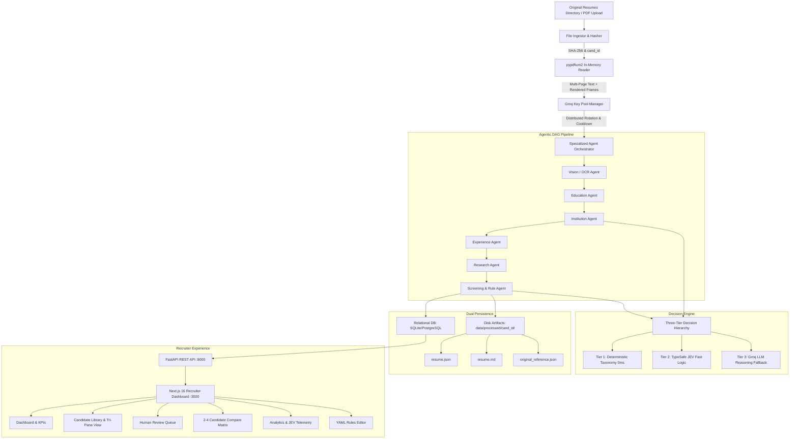
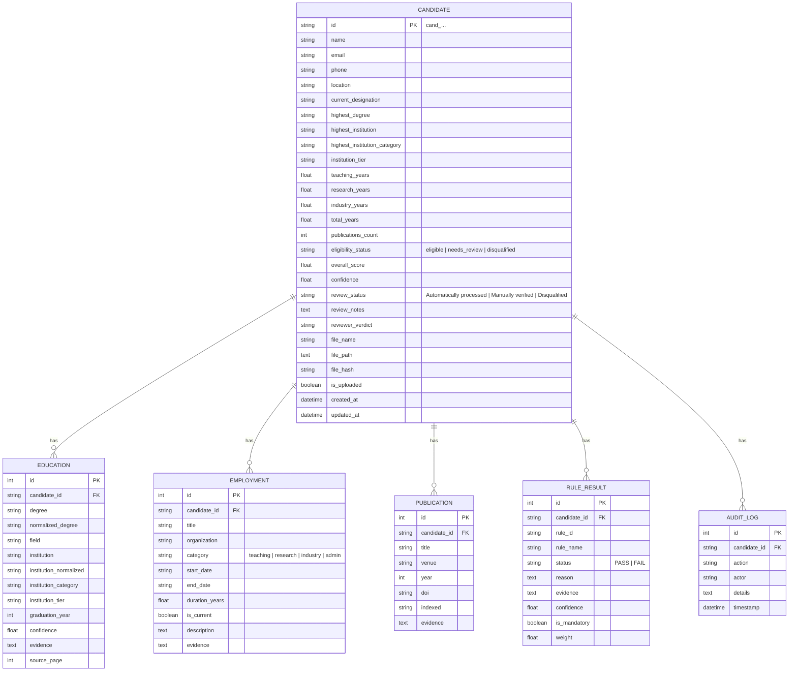

# 🧠 FacultyScreen Brain: Complete Architecture, Agents, & Technical Specifications

> **The Definitive Developer Mind Map & Architectural Manual for FacultyScreen**  
> *AI-Powered Academic Faculty Screening, Multimodal Extraction, & Explainable Decision-Support System.*

---

## 📑 Table of Contents

1. [Executive Summary & Core Philosophy](#1-executive-summary--core-philosophy)
2. [End-to-End System Blueprint](#2-end-to-end-system-blueprint)
3. [The 7 Specialized AI Agents](#3-the-7-specialized-ai-agents)
4. [Distributed Groq LLM Key Pool & Rate Limiting](#4-distributed-groq-llm-key-pool--rate-limiting)
5. [Three-Tier Fast Decision Hierarchy (JEV / TypeSafe AI)](#5-three-tier-fast-decision-hierarchy-jev--typesafe-ai)
6. [Data Pipeline & Academic Standardization](#6-data-pipeline--academic-standardization)
7. [Database Schema & Storage Architecture](#7-database-schema--storage-architecture)
8. [Complete API Route Map](#8-complete-api-route-map)
9. [Frontend Architecture & Stitch Design System](#9-frontend-architecture--stitch-design-system)
10. [Screening Rule Engine & YAML Configuration](#10-screening-rule-engine--yaml-configuration)
11. [Developer Operations & Troubleshooting](#11-developer-operations--troubleshooting)

---

## 1. Executive Summary & Core Philosophy

**FacultyScreen** is an academic recruitment intelligence platform tailored for Universities, Deans, and Selection Committees. It replaces error-prone manual resume reading and opaque "black-box" applicant tracking systems (ATS) with **100% explainable, quote-verified, deterministic evaluation**.

### Core Tenets
1. **Explainable Decision Support, Not Black-Box Filtering**:
   - The platform never outputs a simple binary pass/fail without explicit rationale.
   - Every evaluated criterion quotes the exact sentence and page from the candidate's CV.
2. **Zero-Pollution Ingestion**:
   - Original PDF/document resumes are read-only. They are never renamed, deleted, moved, or altered.
3. **Multi-Key High-Throughput Resilience**:
   - Groq API keys are rotated in a round-robin distributed pool with automatic 429 backoff cooldown.
4. **Zero-Hallucination Parsing**:
   - If an entity (e.g., graduation year or DOI) does not exist in the resume, it is tagged `null`.
5. **YAGNI & Native Platform First**:
   - Clean, modular Python backend with FastAPI and SQLAlchemy.
   - Clean Next.js 16 frontend with Tailwind CSS and zero unnecessary third-party bloat.

---

## 2. End-to-End System Blueprint



---

## 3. The 7 Specialized AI Agents

The backend architecture is structured around seven distinct, dedicated agents located in `backend/app/agents/`. Each agent possesses a single, well-defined domain responsibility:

```
backend/app/agents/
├── orchestration_agent.py   # Pipeline conductor & workflow manager
├── vision_agent.py          # Multimodal visual OCR & document parser
├── education_agent.py       # Degree extraction & hierarchy standardizer
├── institution_agent.py     # Institution taxonomy & NIRF/NAAC tier classifier
├── experience_agent.py      # Teaching vs research vs industry tenure merger
├── research_agent.py        # Publication, citation, venue & DOI indexing
└── screening_agent.py       # YAML rules evaluator & confidence calculator
```

### Agent 1: Orchestration Agent (`orchestration_agent.py`)
- **Role**: Master pipeline workflow orchestrator.
- **Workflow**:
  1. Computes SHA-256 fingerprint from the document buffer.
  2. Generates a deterministic candidate ID: `cand_{sha256[:10]}`.
  3. Checks disk cache (`data/processed/{candidate_id}/resume.json`). If cached and `force_reprocess=False`, returns instantly.
  4. Dispatches the file sequentially across Vision ➔ Education ➔ Institution ➔ Experience ➔ Research ➔ Screening agents.
  5. Assembles the final canonical `ResumeProfile` Pydantic model.
  6. Writes output artifacts (`resume.json`, `resume.md`, `original_reference.json`) and commits to the database repository.

### Agent 2: Vision Agent (`vision_agent.py`)
- **Role**: Multimodal document understanding & OCR.
- **Engine**:
  - Uses `pypdfium2` to render PDF pages into 150 DPI JPEG frames without disk I/O.
  - Reads text directly across all pages (up to 18,000 characters).
  - Routes to Groq (`openai/gpt-oss-20b` for full text reasoning or `qwen/qwen3.8-27b` for multimodal scanned documents).
  - Outputs structured raw JSON with exact quotation snippets (`source_evidence`).

### Agent 3: Education Agent (`education_agent.py`)
- **Role**: Normalizes academic degrees into standard university hierarchy levels.
- **Normalization Hierarchy**:
  - **Doctorate / Postdoc**: `PhD`, `Ph.D.`, `D.Phil`, `Doctor of Philosophy`, `Postdoc` ➔ `"PhD / Doctorate"`
  - **Postgraduate / Masters**: `M.Tech`, `M.E.`, `M.S.`, `M.Sc`, `MCA`, `MBA` ➔ `"Postgraduate / Masters"`
  - **Undergraduate / Bachelors**: `B.Tech`, `B.E.`, `B.S.`, `B.Sc`, `BCA` ➔ `"Undergraduate / Bachelors"`
- **Validation**: Enforces chronological graduation plausibility and verifies degree field tags.

### Agent 4: Institution Agent (`institution_agent.py`)
- **Role**: Categorizes academic institutions and establishes prestige tiers.
- **Taxonomy**:
  - **Tier 1 (Apex National)**: IITs, IISc, IIMs, AIIMS, ISI.
  - **Tier 2 (Premier National)**: NITs, IIITs, BITS Pilani, Top Central Universities (DU, JNU, BHU, UoH).
  - **Tier 3 (Accredited State & Established Private)**: State Universities, Anna University, Jadavpur, VIT, Manipal.
  - **Tier 4 (Affiliated Colleges)**: Regional private institutions.
  - **Tier 0 (International)**: Stanford, MIT, Oxford, NUS, etc.
- **Matching Mechanism**: Uses exact and fuzzy aliases from `data/institutions/institutions.json`, escalating to JEV/LLM when ambiguous.

### Agent 5: Experience Agent (`experience_agent.py`)
- **Role**: Tenure disaggregation and non-overlapping interval consolidation.
- **Categories**:
  1. **Teaching**: Assistant Professor, Associate Professor, Professor, Lecturer, Visiting Faculty.
  2. **Research**: Postdoctoral Fellow, Research Scientist, JRF, SRF, Project Assistant.
  3. **Industry**: Software Engineer, Corporate R&D, Consultant, Technical Architect.
  4. **Administration**: Dean, Head of Department (HOD), Principal, Academic Coordinator.
- **Interval Merging Algorithm**:
  - Automatically detects concurrent tenures (e.g., teaching while completing research).
  - Merges overlapping date intervals mathematically to eliminate double-counting of years.

### Agent 6: Research Agent (`research_agent.py`)
- **Role**: Scholarly publication indexing and citation tracking.
- **Extraction Rules**:
  - Identifies publication title, journal/conference venue, publication year, and DOI.
  - Detects index markings: `Scopus`, `SCI`, `SCIE`, `IEEE Xplore`, `ACM Digital Library`, `Springer`.
  - Extracts patent status (Applied, Published, Granted) and sponsored research grants (SERB, DST, UGC).

### Agent 7: Screening Agent (`screening_agent.py`)
- **Role**: Evaluates candidates against YAML-defined screening rules.
- **Functionality**:
  - Evaluates all mandatory and preferred rules in `config/screening_rules.yaml`.
  - Calculates weighted overall score (0.0 to 100.0%).
  - Assigns an eligibility verdict:
    - `eligible`: All mandatory rules passed and score $\ge 70\%$.
    - `needs_review`: Borderline score ($65\%-70\%$) or confidence $< 0.85$.
    - `disqualified`: One or more mandatory rules failed.
  - Emits human-readable explanation and verbatim evidence string for each rule.

---

## 4. Distributed Groq LLM Key Pool & Rate Limiting

The Groq integration is managed by `GroqKeyPool` in `backend/app/groq/pool.py`.

### Key Features
1. **Dynamic Multi-Key Parsing**:
   - Reads `GROQ_API_KEYS` (comma-separated) or checks for numbered keys (`GROQ_API_KEY_1`, `GROQ_API_KEY_2`, etc.) in `.env`.
   - Supports 5 active Groq API keys simultaneously.
2. **Round-Robin Load Distribution**:
   - Distributes extraction requests evenly across all active keys using atomic thread-safe rotation.
3. **Automatic 429 Cooldown & Failover**:
   - When a key encounters a rate limit (`RateLimitError` or HTTP 429), it is placed in cooldown for 60 seconds.
   - The pool immediately and transparently fails over to the next available key without failing the user request.
4. **Paced Execution**:
   - Enforces a 100ms inter-request pacing delay to prevent burst limit triggers.
5. **Telemetry Endpoint**:
   - Active status, request counts, and cooldown states per key are exposed via `/api/settings/groq-telemetry`.

### Groq Model Assignments
- **Text Reasoning & Fact Extraction**: `openai/gpt-oss-20b`
  - Parameters: `temperature=0.1`, `max_completion_tokens=4096`, `reasoning_format='hidden'`.
  - Output: Complete, strictly valid JSON in $\approx 1.5$ seconds.
- **Visual Scanned Document Extraction**: `qwen/qwen3.8-27b`
  - Parameters: `temperature=0.2`, `max_completion_tokens=900`.
  - Input: Base64-encoded high-DPI image frames for visual OCR.

---

## 5. Three-Tier Fast Decision Hierarchy (JEV / TypeSafe AI)

To maximize speed and minimize API costs, classification and rule evaluation use a three-tier decision hierarchy:

```
[Request: Classify Institution / Evaluate Degree / Check Rule]
                          │
                          ▼
            [ Tier 1: Deterministic Engine ]
             - Local Taxonomy (43+ institutions)
             - Compiled Regular Expressions
             - Execution time: 0.05ms | Cost: $0.00
                          │
                   (If unmatched)
                          ▼
            [ Tier 2: TypeSafe AI / JEV ]
             - Structured Fast Decision Client
             - Model: jev-v1-fast
             - Execution time: ~80ms | Cost: Minimal
                          │
                   (If ambiguous)
                          ▼
            [ Tier 3: Groq LLM Reasoning ]
             - Full Prompt Reasoning Escalation
             - Execution time: ~1500ms
```

---

## 6. Data Pipeline & Academic Standardization

The end-to-end resume lifecycle follows an 8-stage pipeline:

```
INGEST ➔ EXTRACT ➔ NORMALIZE ➔ CLASSIFY ➔ VALIDATE ➔ SCREEN ➔ CURATE ➔ STORE
```

1. **Ingest**: File discovery across `.pdf`, `.png`, `.jpg`, `.jpeg`. Checksum validation.
2. **Extract**: Text and visual extraction via `pypdfium2` and Groq.
3. **Normalize**: Degree names mapped to canonical academic labels; date strings parsed into standard ISO dates.
4. **Classify**: Institution categorization into IIT/NIT/Central/State/Private/Intl; experience categorized into Teaching, Research, and Industry.
5. **Validate**: Sanity-check dates, ensuring start dates precede end dates and graduation years align with career timelines.
6. **Screen**: Evaluation of YAML screening rules with score weighting and confidence calculation.
7. **Curate**: Compilation of audit logs, reviewer action slots, and Markdown document generation.
8. **Store**: Dual persistence to SQLite and filesystem artifacts directory.

---

## 7. Database Schema & Storage Architecture

### Relational Schema (SQLAlchemy / SQLite)

The database schema is defined in `backend/app/database/models.py`:



### Filesystem Storage Layout

Generated outputs per candidate reside under `data/processed/{candidate_id}/`:

```
data/
├── facultyscreen.db                     # Primary SQLite database
└── processed/
    └── cand_a1b2c3d4e5/
        ├── original_reference.json      # Original filename, absolute path, SHA-256
        ├── resume.json                  # Complete canonical ResumeProfile JSON
        ├── resume.md                    # Human-readable Markdown summary
        └── metadata.json                # Processing time, LLM tokens, model name
```

---

## 8. Complete API Route Map

All REST endpoints are prefixed with `/api` and defined in `backend/app/api/routes/`:

### Candidate Management (`routes/candidates.py`)
| Method | Endpoint | Description | Query / Body Parameters |
|---|---|---|---|
| `GET` | `/api/candidates` | List & filter candidates | `search`, `degree`, `institution_category`, `min_teaching_years`, `eligibility_status`, `review_status`, `uploaded_only`, `sort_by`, `sort_desc`, `limit`, `offset` |
| `GET` | `/api/candidates/{id}` | Full candidate profile | Path: `id` |
| `GET` | `/api/candidates/compare` | Compare 2 to 4 candidates side-by-side | `ids` (comma-separated string) |
| `POST` | `/api/candidates/{id}/review` | Submit recruiter review verdict | Body: `{ verdict: "approved"\|"disqualified", notes: "..." }` |
| `DELETE`| `/api/candidates/{id}` | Delete candidate & artifacts | Path: `id` |
| `DELETE`| `/api/candidates/clear-all` | Clear all candidates & processed data | None |

### Resume Ingestion (`routes/resumes.py`)
| Method | Endpoint | Description | Query / Body Parameters |
|---|---|---|---|
| `GET` | `/api/resumes` | List all discovered resumes in folder | None |
| `POST` | `/api/resumes/upload` | Upload and process fresh PDF | Multipart form data: `file: UploadFile` |
| `GET` | `/api/resumes/{id}` | Metadata reference of resume | Path: `id` |
| `GET` | `/api/resumes/{id}/result` | Processed result JSON | Path: `id` |
| `GET` | `/api/resumes/{id}/pdf` | Stream original PDF file to browser | Path: `id` |
| `POST` | `/api/resumes/sync` | Re-sync & scan resume directory | None |

### Screening & Queue (`routes/screening.py`)
| Method | Endpoint | Description | Query / Body Parameters |
|---|---|---|---|
| `GET` | `/api/screening/queue` | Candidates flagged for manual review | None |
| `GET` | `/api/screening/rules` | Currently active screening rules | None |
| `POST` | `/api/screening/rescreen` | Re-evaluate rules on processed candidates | None |

### Analytics & Telemetry (`routes/analytics.py`)
| Method | Endpoint | Description | Query / Body Parameters |
|---|---|---|---|
| `GET` | `/api/analytics/summary` | Top-level KPIs & candidate counts | None |
| `GET` | `/api/analytics/distributions` | Degree, tier, & experience histograms | None |
| `GET` | `/api/analytics/funnel` | Screening funnel stages & conversion | None |

### Settings & Configuration (`routes/settings.py`)
| Method | Endpoint | Description | Query / Body Parameters |
|---|---|---|---|
| `GET` | `/api/settings/config` | Read application settings | None |
| `GET` | `/api/settings/groq-telemetry`| Groq key pool load & cooldown stats | None |
| `GET` | `/api/settings/rules` | Fetch raw `screening_rules.yaml` | None |
| `PUT` | `/api/settings/rules` | Save updated `screening_rules.yaml` | Raw YAML / JSON payload |

---

## 9. Frontend Architecture & Stitch Design System

The frontend is built with **Next.js 16 (App Router)**, **React 19**, and **Tailwind CSS 4** in `apps/web/`.

### Design System: Google Stitch Aesthetic
- **Collegiate Navy** (`#1e3a8a` / `#0f172a`): Primary authority, navigation, headers.
- **Emerald** (`#059669` / `#10b981`): Eligible, verified, passing badges.
- **Amber** (`#d97706` / `#f59e0b`): Needs review, warnings, pending verification.
- **Rose** (`#dc2626` / `#ef4444`): Disqualified, mandatory failures.
- **Slate / Glassmorphism**: Neutral cards, backdrop blur modals, clean borders.

### Feature Layout (`apps/web/features/`)
```
apps/web/features/
├── dashboard/      # Screen A: Overview KPIs, pass/fail ratios, quick actions
├── candidates/     # Screen B & C: Searchable library & Tri-Pane Candidate Detail Drawer
├── screening/      # Screen D: Low-confidence review queue & recruiter decision actions
├── comparison/     # Screen E: Side-by-side comparison table (2 to 4 candidates)
├── analytics/      # Screen F: Interactive metric distributions & Groq key pool telemetry
└── settings/       # Screen G: Interactive YAML screening rules editor
```

### Tri-Pane Candidate Inspection
When inspecting any candidate, the screen splits into three synchronized panes:
1. **Left Pane (Profile Summary)**: Photo/initials, name, email, phone, highest degree badge, institution tier badge, and career tenure breakdown.
2. **Center Pane (Extracted Facts & Document)**: Switchable tabs for Overview, Education history, Employment timeline, Publications list, Generated Markdown, and Live PDF Viewer.
3. **Right Pane (AI Screening & Recruiter Verdict)**: List of every rule evaluated with Pass/Fail badges, exact evidence quotes, overall score percentage, and human recruiter review buttons (`Approve Candidate` / `Disqualify Candidate`).

---

## 10. Screening Rule Engine & YAML Configuration

Hiring criteria are declared declaratively in `config/screening_rules.yaml`:

```yaml
version: "1.0.0"
department: "Faculty Selection Board"

rules:
  # Mandatory Rule 1: Doctoral Degree
  - id: "RULE_MIN_DEGREE"
    name: "Earned Doctorate Degree"
    field: "education.highest_degree"
    operator: "in"
    required_value: ["PhD / Doctorate", "Postdoctoral"]
    is_mandatory: true
    weight: 35
    failure_message: "Candidate does not possess an earned Doctorate/Ph.D. degree."

  # Mandatory Rule 2: Minimum Teaching Experience
  - id: "RULE_MIN_TEACHING_EXP"
    name: "Minimum Teaching Experience"
    field: "experience.teaching_years"
    operator: ">="
    required_value: 2.0
    is_mandatory: true
    weight: 25
    failure_message: "Teaching tenure is below the mandatory minimum of 2.0 years."

  # Preferred Rule 3: Scholarly Publications
  - id: "RULE_MIN_PUBLICATIONS"
    name: "Scholarly Publications"
    field: "research.publications_count"
    operator: ">="
    required_value: 2
    is_mandatory: false
    weight: 20
    failure_message: "Candidate has fewer than 2 indexed publications."

  # Preferred Rule 4: Tier-1 / Tier-2 Institution Pedigree
  - id: "RULE_INSTITUTION_TIER"
    name: "Premier Institution Pedigree"
    field: "education.institution_tier"
    operator: "in"
    required_value: ["Tier 1", "Tier 2", "Tier 0"]
    is_mandatory: false
    weight: 20
    failure_message: "Highest qualification is not from a Tier 1 or Tier 2 institution."

settings:
  overall_passing_score_percentage: 70.0
  minimum_confidence_for_auto_approval: 0.85
  needs_review_confidence_floor: 0.65
```

### Supported Operators
- `>=` / `<=` / `>` / `<`: Numeric threshold comparisons (e.g., years of experience, publication counts).
- `==` / `!=`: Exact string or boolean equality.
- `in`: Membership checks against a list of accepted categories or degree levels.
- `contains`: Substring matching (case-insensitive).
- `regex`: Regular expression pattern matching.

---

## 11. Developer Operations & Troubleshooting

### One-Click Launchers
- **Start Platform**: Double-click `run_facultyscreen.bat` in the root directory.
  - Automatically verifies virtual environment `.venv`.
  - Boots FastAPI Backend on `http://127.0.0.1:8000`.
  - Boots Next.js Frontend on `http://localhost:3000`.
  - Opens the browser automatically.
- **Stop Platform**: Double-click `stop_facultyscreen.bat`.
  - Cleanly identifies and terminates background processes on ports 8000 and 3000.

### Running Backend Tests
Execute unit and integration tests using Python's module runner:
```bash
# Run entire test suite
.venv\Scripts\python -m pytest tests/

# Run specifically integration API tests
.venv\Scripts\python -m pytest tests/integration/test_api.py

# Run unit tests
.venv\Scripts\python -m pytest tests/unit/test_engine.py
```

### Common Developer FAQs

**Q1: What happens if all Groq API keys are rate limited?**  
*A*: `GroqKeyPool` tracks key cooldown expiries. If all keys are cooling down, it identifies the key with the earliest cooldown expiry, pauses for the brief difference (typically $\le 3$s), and proceeds. If mock mode is forced (`MOCK_MODE=True`), it produces realistic synthetic profiles without any network requests.

**Q2: Are original PDF resumes modified in any way?**  
*A*: No. The ingestion engine only opens original PDFs in read-only binary mode to compute SHA-256 hashes and extract text. All processed files and metadata are written to `data/processed/{candidate_id}/`.

**Q3: How do I completely clear existing candidate data for a fresh start?**  
*A*: Either click **"Clear All Data"** in the top navigation bar of the web app or issue a `DELETE` request to `http://localhost:8000/api/candidates/clear-all`. This purges the SQLite tables and removes `data/processed/`, while keeping your original input resumes untouched.

---

*FacultyScreen Architecture & Brain Manual — Maintained for University Academic Recruitment Committees.*
