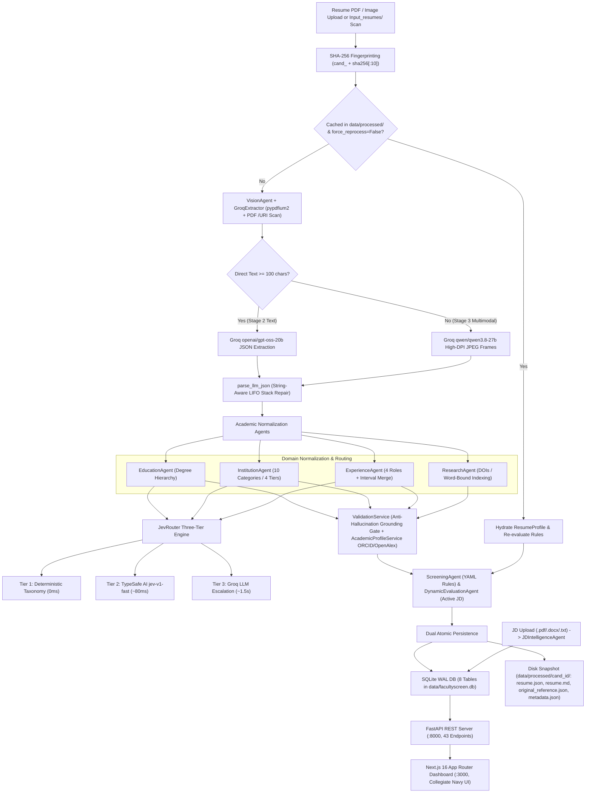
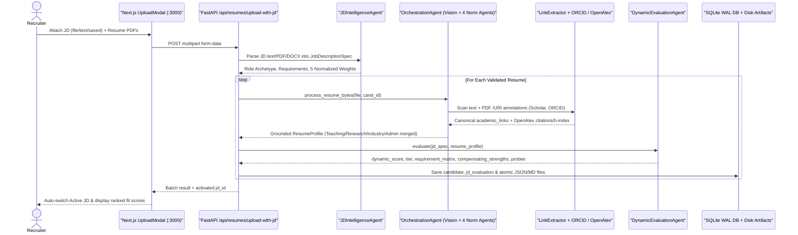
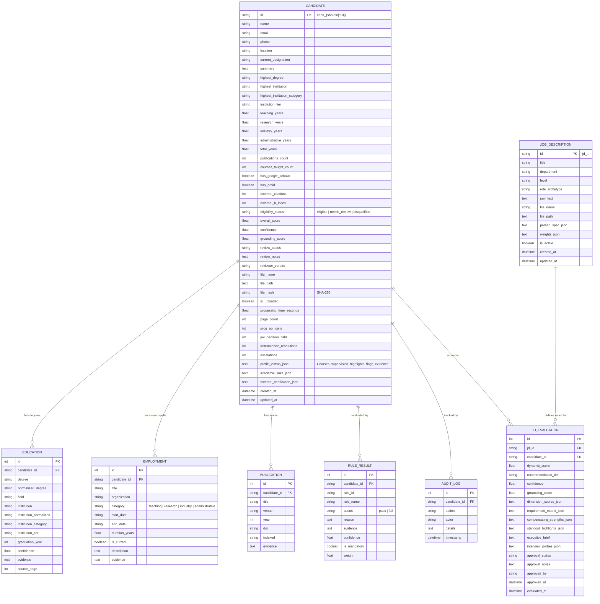

# FacultyScreen — Master Architecture, Technical Evidence & Single Source of Truth (`BRAIN.md`)

> **Version:** `v2.0.0-agentic` (Pipeline) / `v1.0.0` (Platform Config)  
> **Status:** Production-Hardened Full-Stack System (`50/50` Backend Tests Passing | `0` ESLint/TSC/Anti-Slop Violations | Next.js `16.3.8` Production Build Clean)  
> **Purpose:** Single authoritative source of truth for **FacultyScreen** — engineered for technical reports, architecture reviews, committee documentation, and 12-slide presentation decks. Every number, route, schema column, model ID, formula, and verification result in this document is verified directly against the live codebase and SQLite database.

---

## Table of Contents

1. [Executive Summary, Problem Statement & Core Philosophy](#1-executive-summary-problem-statement--core-philosophy)
2. [Project Metrics & Evidence Snapshot](#2-project-metrics--evidence-snapshot)
3. [End-to-End System Architecture Blueprint](#3-end-to-end-system-architecture-blueprint)
4. [The 9 Specialized AI Agents & Multi-Agent Orchestration](#4-the-9-specialized-ai-agents--multi-agent-orchestration)
5. [Dynamic JD-Driven Evaluation, Compensating Strengths & Scoring Math](#5-dynamic-jd-driven-evaluation-compensating-strengths--scoring-math)
6. [Three-Tier Hybrid Decision Hierarchy (Deterministic → JEV → Groq)](#6-three-tier-hybrid-decision-hierarchy-deterministic--jev--groq)
7. [Distributed Groq LLM Key Pool, JSON Repair & Multimodal Extraction](#7-distributed-groq-llm-key-pool-json-repair--multimodal-extraction)
8. [Anti-Hallucination Grounding, Validation & Academic Link Verification](#8-anti-hallucination-grounding-validation--academic-link-verification)
9. [Database Schema, Persistence & Filesystem Storage Architecture](#9-database-schema-persistence--filesystem-storage-architecture)
10. [Complete REST API Reference (All 43 Endpoints)](#10-complete-rest-api-reference-all-43-endpoints)
11. [Configuration-Driven Architecture (4 Hot-Reloadable YAML Files + Taxonomy)](#11-configuration-driven-architecture-4-hot-reloadable-yaml-files--taxonomy)
12. [Frontend Architecture & FacultyScreen Anti-Slop Design System](#12-frontend-architecture--facultyscreen-anti-slop-design-system)
13. [Security, Privacy & Production Hardening Controls](#13-security-privacy--production-hardening-controls)
14. [Empirical Dataset Evidence, Quality Audits & Automated Test Matrix](#14-empirical-dataset-evidence-quality-audits--automated-test-matrix)
15. [Architecture Decision Records (ADRs), Vector DB Trade-Offs & Future Roadmap](#15-architecture-decision-records-adrs-vector-db-trade-offs--future-roadmap)
16. [PPT Slide Deck Storyboard (12 Slides), Report Blueprint & Developer Operations](#16-ppt-slide-deck-storyboard-12-slides-report-blueprint--developer-operations)

---

## 1. Executive Summary, Problem Statement & Core Philosophy

### 1.1 The Problem in Academic Faculty Recruitment
Academic hiring committees (Deans, Search Chairs, Heads of Department) face a structural screening bottleneck that standard corporate Applicant Tracking Systems (ATS) and generic LLM wrappers fail to solve:
1. **Multi-Page Heterogeneous Academic CVs:** Academic CVs span 2–15+ pages mixing degrees, theses, concurrent appointments (e.g., Assistant Professor + Funded Lab PI + Visiting Industry Fellow), courses taught, PhD/Masters scholar supervision, Scopus/SCI journals, patents, grants, and clickable hyperlinks (Google Scholar, ORCID).
2. **Naive Date Summation Inflates Tenure:** Summing individual employment rows double-counts concurrent appointments. Accurate screening requires **interval merging** across disaggregated categories (`teaching`, `research`, `industry`, `administrative`).
3. **Rigid Binary Rules Miss Strong Alternative Candidates:** A Professor of Practice JD or Applied AI Clinical role may list a PhD as preferred/standard, yet an exceptional candidate with a Master's degree + 10 years of Tier-1 corporate R&D + courses taught + patents can be a strong fit if **compensating strengths** are evaluated transparently.
4. **Black-Box AI Risk & Hallucination:** Pure end-to-end LLM scoring fabricates credentials, produces irreproducible numbers, leaks latency/token costs when applied to trivial taxonomy lookups (e.g., recognizing "IIT Bombay"), and provides zero audit trail for university HR governance.

### 1.2 How FacultyScreen Solves It (Comparison Matrix)

| Capability | Manual Committee Review | Traditional Corporate ATS | Generic Single-Prompt LLM | **FacultyScreen (`v2.0.0-agentic`)** |
|---|---|---|---|---|
| **CV Parsing Mode** | Human reading (slow, fatigue-prone) | Keyword / fragile regex text dump | Unstructured prompt output | **Hybrid 2-Stage Pipeline:** Direct multi-page text extraction + `pypdfium2` Multimodal Vision fallback (`qwen/qwen3.8-27b`) |
| **Tenure Calculation** | Manual estimation | Ignored or raw keyword counts | LLM arithmetic errors & double-counting | **Deterministic Interval Merging** across Teaching, Research, Industry & Admin ($O(n \log n)$) |
| **Classification Cost & Latency** | High human hours | N/A | Every lookup triggers full LLM call | **Three-Tier Routing (`JevRouter`):** Deterministic taxonomy (`0ms`) → TypeSafe JEV (`jev-v1-fast`) → Groq LLM escalation |
| **Evaluation Flexibility** | Subjective | Rigid keyword knockouts | Unpredictable floating score | **Dual Engine:** Deterministic YAML Baseline Rules **+** Dynamic Per-JD Evaluation with Compensating Strengths & Instant Weight Re-scoring |
| **Citation & Identity Verification** | Manual Google searches | None | Hallucinates scholar metrics | **PDF `/URI` Annotation Scanner + ISO 7064 ORCID Checksum** + Official **ORCID v3.0 & OpenAlex API** lookup |
| **Auditability & Grounding** | Handwritten notes | Opaque keyword score | Uncited paragraphs | **`ValidationService` Grounding Gate** + Field-level verbatim evidence + page references (`p. X`) + SQLite AuditLog |
| **Recruiter UI** | Spreadsheets & PDF tabs | Generic HR forms | Chat box | **Anti-Slop Collegiate Navy Dashboard:** Next.js 16 + React 19 + Tailwind v4 (`0` AI-slop violations) |

### 1.3 Five Core Engineering Tenets
1. **Explainable Decision Support, Never a Black Box:** Every rule check, JD requirement alignment, and extracted credential carries an explicit status, rationale, confidence score, verbatim CV quote, and source page reference.
2. **Zero-Pollution Ingestion:** Original source PDFs in `RESUMES_DIR` (`Input_resumes/`) are read-only and never renamed, moved, or overwritten. Candidate IDs (`cand_{sha256[:10]}`) derive deterministically from file bytes.
3. **Human-Like Dynamic JD Fit + Compensating Strengths:** Committees can screen against static departmental minimums (`config/screening_rules.yaml`) or upload any Job Description and tune 5 rubric weights dynamically with zero-LLM instant score recalculation.
4. **Resilience Without Vendor Lock-In:** `GroqKeyPool` distributes load across multiple API keys with lock-free 429 cooldown failover, `JevRouter` falls back cleanly to local services when offline, and `MOCK_MODE=True` allows zero-network demos and testing.
5. **Anti-Slop Academic Authority in UI:** Follows a strict 90/8/2 Collegiate Navy (`#1e3a8a`) visual standard — crisp `1px` hairline borders, `font-mono tabular-nums` metrics, zero decorative gradients, zero emojis, and verified 100% icon stroke discipline.

---

## 2. Project Metrics & Evidence Snapshot

*Verified live across repository files, SQLite database (`data/facultyscreen.db`), test runner, and Next.js build output:*

| Metric Category | Exact Verified Measurement | Source Evidence |
|---|---|---|
| **Backend Python Code (`backend/app/`)** | **51 files, 8,532 LOC** | FastAPI, 9 Agents, Services, Groq Pool, SQLAlchemy Repository, Utilities |
| **Frontend Web Code (`apps/web/`)** | **31 files, 8,885 LOC** (incl. 9 UI primitives + 4 Detail panels) | Next.js `16.3.8`, React `19.2.8`, TypeScript `5`, Tailwind CSS `v4` |
| **Automated Test Suite (`tests/`)** | **13 files, 1,780 LOC — 50/50 tests passing in 2.60s** | `pytest` across 8 unit suites & 2 FastAPI integration suites |
| **Utility & Debug Scripts (`scripts/`)** | **16 files, 868 LOC** | CLI batch parser (`parse_resumes.py`) + 15 diagnostic scripts |
| **Total Repository Codebase** | **111 code files, 20,065 LOC** | Combined `backend/app/`, `apps/web/`, `tests/`, `scripts/` |
| **Specialized AI Agents** | **9 agents** (`backend/app/agents/`) | Vision, Education, Institution, Experience, Research, Screening, JD Intelligence, Dynamic Evaluation, Orchestration |
| **REST API Surface** | **43 HTTP endpoints** across 6 routers + system health | Candidates (7), JDs (9), Resumes (10), Screening (3), Analytics (1), Settings (11), System (2) |
| **Relational Database Schema** | **8 SQLite WAL tables** (`busy_timeout=5000`) | 44-col `candidates`, `education`, `employment`, `publications`, `rule_results`, `audit_logs`, `job_descriptions`, `jd_evaluations` |
| **Curated Knowledge Base & Config** | **81 institutions** + **4 hot-reloadable YAML configs** | `data/institutions/institutions.json`, `app_config.yaml`, `llm_config.yaml`, `prompts.yaml`, `screening_rules.yaml` |
| **Live Corpus Snapshot (`data/facultyscreen.db`)** | **33 source PDFs** in `Input_resumes/` / **43 SQLite candidates**, **126 education rows**, **238 employment rows**, **45 publications**, **215 rule results**, **61 audit logs** | Avg Confidence: `92.3%`, Avg Grounding: `100.0%`, Avg Processing: `0.06s` (cached/synced DB telemetry), Avg Teaching: `3.08 yrs` |
| **Frontend Quality & Anti-Slop Audit** | **0 errors/warnings** (`eslint`, `tsc --noEmit`, `next build`) | **0/27 files** with anti-slop violations; **106/106** `lucide-react` icons at `strokeWidth={1.5}` |

---

## 3. End-to-End System Architecture Blueprint

### 3.1 High-Level Data & Control Flow



### 3.2 Complete Repository Directory Architecture

```
Prj4/
├── Input_resumes/                          # 33 Read-only source-of-truth PDF resumes (NEVER mutated)
├── apps/web/                               # Next.js 16.3.8 + React 19.2.8 + Tailwind CSS v4 (31 files, 8,885 LOC)
│   ├── app/                                # App Router: layout.tsx, globals.css (@theme navy-*), page.tsx
│   ├── components/                         # App shell & shared design system
│   │   ├── ui/                             # 8 Shared Primitives: Card, Button, StatusPill, MetricTile, ProgressBar, Tabs, SectionHeader, EmptyState
│   │   ├── Navbar.tsx                      # Global search, md+ Active JD Switcher, Sync Folder, Upload trigger
│   │   ├── Sidebar.tsx                     # Crisp white navigation rail with Collegiate Navy active state & backend telemetry
│   │   └── UploadModal.tsx                 # Dual Resume + JD Upload modal (4 JD modes, .pdf/.png/.jpg/.jpeg/.webp & .pdf/.docx/.txt/.md)
│   ├── features/
│   │   ├── dashboard/DashboardOverview.tsx # Dynamic JD/Baseline KPIs, degree chart, review alert box, top candidates table
│   │   ├── jds/JDWorkspaceView.tsx         # JD upload/parser, 5-dimension navy weight sliders, live sum badge, criteria CRUD, batch eval
│   │   ├── candidates/
│   │   │   ├── CandidateTable.tsx          # Multi-facet filter bar, sticky zebra table, active sort arrows, Scholar/ORCID chips, CSV export
│   │   │   ├── CandidateDetailView.tsx     # Orchestrator for modular 5-tab candidate dossier
│   │   │   └── detail/                     # CandidateHeaderCard, OverviewInsightsTab, CareerPortfolioTab, ResearchAndEvidenceTabs
│   │   ├── screening/ReviewQueueView.tsx   # Human-in-the-loop low-confidence queue with trigger explanations & adjudication
│   │   ├── comparison/CandidateComparisonView.tsx # 2-to-4 applicant side-by-side matrix (metrics, JD requirements & baseline rules)
│   │   ├── analytics/AnalyticsView.tsx     # Pipeline funnel KPIs, rule pass rates, institution/score/experience charts, Groq key telemetry
│   │   └── settings/SettingsView.tsx       # 4-tab YAML Config Editor (Screening Rules, Models & Pool, Prompts, Pipeline & System)
│   ├── lib/api.ts                          # Typed REST API client (zero silent mock fallbacks; strictly preserved)
│   └── types/candidate.ts                  # Canonical TypeScript domain & API interfaces (531 LOC)
├── backend/app/                            # FastAPI Backend (51 Python files, 8,532 LOC)
│   ├── agents/                             # 9 specialized domain, extraction, JD, evaluation & orchestration agents
│   ├── api/routes/                         # 6 FastAPI route modules (41 routes) + main.py (2 routes) = 43 total endpoints
│   ├── database/                           # SQLAlchemy 2.0 ORM models, WAL setup, CandidateRepository, JDRepository
│   ├── groq/                               # GroqKeyPool (multi-key round-robin & backoff) + GroqExtractor
│   ├── pipelines/                          # Batch directory scan & orchestrator wrapper
│   ├── schemas/                            # Pydantic v2 models: ResumeProfile, JobDescriptionSpec, CandidateJDEvaluation
│   ├── services/                           # Normalization, validation, screening, academic enrichment, JEV 3-tier router
│   ├── utils/                              # json_utils (LIFO repair, security paths, atomic writes), link_extractor, markdown_generator
│   ├── config.py & config_manager.py       # .env Settings + schema-validated atomic YAML ConfigManager
│   └── main.py                             # FastAPI entry point, lifespan initialization, CORS, router mounting
├── config/                                 # Hot-reloadable declarative YAML configs
│   ├── app_config.yaml                     # Taxonomies, pipeline limits, review thresholds, external enrichment, JD eval policy
│   ├── llm_config.yaml                     # Groq aliases, pool timeouts/retries, JEV endpoint, 9 per-task overrides
│   ├── prompts.yaml                        # 8 modular prompt sections editable via UI
│   └── screening_rules.yaml                # Mandatory & preferred eligibility rules + passing cutoffs
├── data/
│   ├── institutions/institutions.json      # 81 curated Indian & international academic institutions with category & tier
│   ├── facultyscreen.db                    # Primary SQLite WAL relational database (8 tables)
│   ├── processed/{candidate_id}/           # Per-candidate resume.json, resume.md, original_reference.json, metadata.json
│   ├── uploads/ & jds/                     # Stored uploaded resumes and parsed JD documents
├── docs/                                   # BRAIN.md, DESIGN.md, AUDIT_REPORT.md, AGENTIC_SYSTEM_AUDIT.md, architecture.md, decisions.md
├── scripts/                                # CLI resume processor + 15 diagnostic/verification scripts
├── tests/                                  # 10 active pytest files (50 tests) covering unit & API integration workflows
├── .agent/rules/facultyscreen-ui.md        # Glob-triggered anti-slop Tailwind v4 enforcement rule
├── docker-compose.yml & Makefile           # Multi-container backend (:8000) + Next.js web (:3000) deployment
└── start.bat                               # Unified interactive Windows controller (start, stop, restart, status, menu)
```

---

## 4. The 9 Specialized AI Agents & Multi-Agent Orchestration

Every agent in `backend/app/agents/` has a single domain responsibility, uses `config_manager` + `JevRouter` / `GroqKeyPool` rather than hardcoded logic, and reports execution telemetry back to `OrchestrationAgent`.

| # | Agent Class & File | LOC | Primary Responsibility | Routing / Execution Strategy | Output Artifact / Field |
|---|---|---|---|---|---|
| 1 | `OrchestrationAgent` (`orchestration_agent.py`) | 392 | Master DAG conductor, SHA-256 ID assignment, caching, telemetry aggregation, dual persistence | Coordinates Agents 2–7 + `ValidationService` + `AcademicProfileService` | Canonical `ResumeProfile` + DB rows + disk snapshot |
| 2 | `VisionAgent` (`vision_agent.py`) | 143 | Document ingestion, text layer scan, image normalization (`.webp`/`.png`/`.jpg` → JPEG), frame rendering | `pypdfium2` + Pillow + `GroqExtractor` | Raw structured extraction JSON + PDF `/URI` links |
| 3 | `EducationAgent` (`education_agent.py`) | 113 | Normalizes degree strings into 8 canonical academic levels & selects highest degree | 3-tier `JevRouter` (`EducationService` → JEV → `openai/gpt-oss-20b`) | Normalized `EducationEntry[]`, `highest_degree` |
| 4 | `InstitutionAgent` (`institution_agent.py`) | 127 | Maps raw university/institute strings to canonical names, 10 categories, and 4 tiers | 3-tier `JevRouter` (81-entry `institutions.json` → JEV → Groq) | `institution_normalized`, `institution_category`, `institution_tier` |
| 5 | `ExperienceAgent` (`experience_agent.py`) | 136 | Disaggregates roles (`teaching`, `research`, `industry`, `administrative`) & merges overlapping dates | 3-tier `JevRouter` (`ExperienceService` → JEV → Groq) + interval merger | Deduplicated `EmploymentEntry[]` + `ExperienceBreakdown` |
| 6 | `ResearchAgent` (`research_agent.py`) | 17 | Delegates scholarly output normalization, indexing, and publication deduplication | `ResearchService` (`\b` word-bound regex index detection + title/DOI dedup) | `ResearchProfile` (publications, grants, patents, books, domains) |
| 7 | `ScreeningAgent` (`screening_agent.py`) | 17 | Evaluates candidate against `config/screening_rules.yaml` mandatory & weighted rules | Deterministic rule interpreter (`ScreeningService` with `RLock`) | `ScreeningResult` (`overall_score`, `eligibility_status`, per-rule rationale) |
| 8 | `JDIntelligenceAgent` (`jd_agent.py`) | 222 | Parses uploaded `.pdf`/`.docx`/`.txt`/`.md` or raw JD text into structured weighted rubrics | Groq `jd_parser` (`openai/gpt-oss-20b`, `max_tokens=2500`) + deterministic fallback | `JobDescriptionSpec` (archetype, requirements, 5 normalized weights) |
| 9 | `DynamicEvaluationAgent` (`evaluation_agent.py`) | 614 | Evaluates candidate vs active JD holistically with compensating strengths, probes & grounding check | Deterministic pre-signals + Groq `dynamic_evaluator` (`3000` tok) + offline heuristic | `CandidateJDEvaluation` (score, tier, 5D scores, matrix, compensating rationale) |

### 4.1 Dual Upload & Dynamic Evaluation Sequence Diagram



---

## 5. Dynamic JD-Driven Evaluation, Compensating Strengths & Scoring Math

### 5.1 Role Archetypes & Rubric Adaptation (`JDIntelligenceAgent`)
Unlike fixed ATS scoring templates, `JDIntelligenceAgent` classifies every Job Description into one of five faculty archetypes and adjusts default weights accordingly:
- `research_intensive` (Research Faculty / Lab Chairs): emphasizes `research_and_impact` and `requirement_fit`.
- `teaching_focused` (Lecturer / Teaching Track / Senior Faculty): emphasizes `teaching_fit`, courses taught, and pedagogical portfolio.
- `practice_industry` (Professor of Practice / Clinical / Applied Engineering): elevates `alternative_strength_credit` and sets `allow_compensating_strengths = True` so senior industry impact can offset formal degree gaps.
- `leadership_admin` (Dean / Director / Chair): values `administrative_years`, accreditation leadership, and institutional stewardship.
- `balanced` (Standard Assistant/Associate Professor): uses `config/app_config.yaml` defaults:
  - `requirement_fit = 0.35`, `domain_semantic_fit = 0.25`, `teaching_fit = 0.15`, `research_and_impact = 0.15`, `alternative_strength_credit = 0.10`.

Whenever a recruiter edits weights in the JD Workspace sliders, `JDWeights.normalized()` proportionally rescales weights so $\sum_{i=1}^{5} w_i = 1.0$, and `DynamicEvaluationAgent.recalculate_for_updated_jd()` recomputes every stored evaluation score **in milliseconds with zero LLM calls**.

### 5.2 Exact Mathematical Scoring Formulas (`evaluation_agent.py`)

1. **Domain Semantic Similarity (`_semantic_similarity(Q, C)`):**  
   Tokens are filtered against 24 domain stopwords (`_SEMANTIC_STOPWORDS` such as `professor`, `experience`, `degree`, `university`) so domain-specific skills drive the match:
   $$\text{sim}(Q, C) = \min\!\Big(100.0,\; \big(0.30 \cdot \cos(Q, C) + 0.70 \cdot \text{recall}(Q, C)\big) \times 100.0\Big)$$

2. **Deterministic Teaching Fit Signal (`teaching_fit` $\in [0, 100]$):**
   $$\text{teaching\_fit} = \min\!\Big(100.0,\; \min(65.0,\; 16.0 \cdot T_{\text{yrs}}) + \min(25.0,\; 12.0 \cdot N_{\text{courses}}) + \min\!\big(15.0,\; 4.0 \cdot (2 S_{\text{PhD\_done}} + S_{\text{PhD\_ong}} + S_{\text{Masters}})\big)\Big)$$

3. **Deterministic Research & Impact Signal (`research_and_impact` $\in [0, 100]$):**
   $$\text{applied\_bonus} = \begin{cases} \min(20.0,\; 2.5 \cdot I_{\text{yrs}}) & \text{if } \text{allow\_compensating\_strengths} \\ 0.0 & \text{otherwise} \end{cases}$$
   $$\text{research\_impact} = \min\!\Big(100.0,\; \min(40.0,\; 10.0 \cdot N_{\text{pubs}}) + \min(25.0,\; 15.0 \cdot N_{\text{grants}}) + \min(25.0,\; 15.0 \cdot N_{\text{patents}}) + \min(20.0,\; 3.0 \cdot h_{\text{OpenAlex}}) + \text{applied\_bonus}\Big)$$

4. **Compensating Alternative Strength Signal (`alternative_strength_credit` $\in [0, 100]$):**
   $$\text{alt\_credit} = \min\!\Big(100.0,\; \min(45.0,\; 6.0 \cdot I_{\text{yrs}}) + \min(25.0,\; 8.0 \cdot A_{\text{yrs}}) + \min(15.0,\; 10.0 \cdot N_{\text{awards}}) + \min(20.0,\; 10.0 \cdot (N_{\text{certs}} + N_{\text{patents}}))\Big)$$

5. **Composite Dynamic Fit Score:**
   $$S_{\text{dynamic}} = \sum_{d \in \{ \text{req}, \text{dom}, \text{teach}, \text{res}, \text{alt} \}} w_d^{\text{norm}} \cdot s_d$$

6. **Recommendation Tier Classification & Per-JD Committee Verdicts:**
   - **Tiers:** `strong_match` ($S_{\text{dynamic}} \ge 78.0$), `strong_alternative_fit` ($S_{\text{dynamic}} \ge 65.0$ or high compensating strength credit), `conditional_review` ($S_{\text{dynamic}} \ge 50.0$), `low_alignment` ($S_{\text{dynamic}} < 50.0$).
   - **Per-JD Committee Approvals (`approval_status`):** Committees record independent decisions per `(jd_id, candidate_id)` pair — `pending`, `approved` (Shortlist), `approved_alternative` (Approve Alt Track), `interview_recommended` (Interview), `hold`, or `rejected` (Decline) — preserving historical audit logs without overwriting decisions across other open JDs.

---

## 6. Three-Tier Hybrid Decision Hierarchy (Deterministic → JEV → Groq)

`backend/app/services/jev/jev_router.py` guarantees that **trivial or catalog-known decisions never burn LLM tokens or suffer network latency**, while ambiguous cases are handled transparently:

| Tier | Engine / Backing Store | Trigger Condition | Typical Latency | Fallback Behavior | Telemetry Counter |
|---|---|---|---|---|---|
| **Tier 1: Deterministic** | Curated JSON taxonomy (`81` institutions in `data/institutions/institutions.json`), degree normalization maps (`EducationService`), keyword/interval engine (`ExperienceService`) | Match confidence ≥ task threshold (`0.75` Education, `0.85` Institution, `0.75` Experience) | **~0.05 ms** (\$0 API cost) | Always succeeds locally | `deterministic_resolutions` |
| **Tier 2: TypeSafe AI / JEV** | Micro-decision REST client (`JevClient`, model `jev-v1-fast`, `timeout=5.0s`) when `TYPESAFE_API_KEY` is configured | Tier 1 confidence $<$ threshold (`needs escalation`) | **~80 ms** | Delegates to `JevDecisions` safe fallback if offline/unconfigured | `jev_decision_calls` |
| **Tier 3: Groq Reasoning Escalation** | Groq LLM (`openai/gpt-oss-20b`) via `GroqKeyPool` with task-specific system/user prompts from `prompts.yaml` | Tier 2 returns `is_escalated=True` or confidence $< 0.85$ | **~600–1,500 ms** | Returns conservative Tier 1/2 result flagged for Human Review if Groq unavailable | `escalations` + `groq_api_calls` |

Thread safety across parallel batch evaluations is protected inside `JevRouter` using `threading.RLock()` and atomic stats snapshots (`/api/analytics/overview`).

---

## 7. Distributed Groq LLM Key Pool, JSON Repair & Multimodal Extraction

### 7.1 `GroqKeyPool` Resilience Engineering (`backend/app/groq/pool.py`)
- **Multi-Source Key Discovery:** Parses comma-separated `GROQ_API_KEYS`, numbered `GROQ_API_KEY_1..N`, and legacy `GROQ_API_KEY`.
- **Atomic Round-Robin Rotation & Lock-Free Sleep:** Tracks per-key `requests`, `cooling_down`, `cooldown_until`, and `rotations_handled`. **Critically, the thread lock is released before sleeping**, preventing one rate-limited call from stalling sibling threads.
- **Transient Fault & 429 Handling:** Default pool config (`config/llm_config.yaml`): `cooldown_seconds=8.0`, `max_cooldown_wait_seconds=5.0`, `max_retries=12`, `pacing_delay_seconds=0.1`, `request_timeout_seconds=60.0`. Honors upstream HTTP `Retry-After` headers and retries transient 5xx/timeout errors before failing over.
- **Zero Secret Leakage:** Sanitized logs expose only `key_index` (e.g., `Key #1`) — never API key prefixes.

### 7.2 3-Stage Multimodal Document Extraction & LIFO JSON Repair (`extractor.py`, `json_utils.py`)
1. **Stage 1 — Embedded PDF Text Layer Extraction:** Uses `pypdfium2` to read text across pages (up to `max_text_chars=28000`) plus `link_extractor` to capture embedded `/URI` link annotations.
2. **Stage 2 — Structured Text Reasoning (`openai/gpt-oss-20b`):** Invoked if extracted text $\ge$ `min_text_chars=100`. Requests `response_format={"type": "json_object"}` (with automatic single fallback retry without `response_format` if an endpoint rejects it). Extracts degrees, courses taught, supervision summary, employment, publications, research projects, awards, academic service, notable highlights, and verbatim `source_evidence`.
3. **Stage 3 — Multimodal Visual OCR Fallback (`qwen/qwen3.8-27b`):** Invoked automatically for image uploads (`.png`, `.jpg`, `.jpeg`, `.webp` normalized via Pillow) or scanned/image-only PDFs (`< 100` chars). Renders pages in-memory at `render_scale=2.0`, max dimensions `[1600, 1600]`, JPEG quality `85`, encoded directly as `data:image/jpeg;base64,...` (zero temp files on disk).
4. **String-Aware LIFO Stack JSON Repair (`parse_llm_json`):** Strips markdown fences and repairs truncated LLM JSON outputs by tracking nested `[` and `{` on a true **LIFO stack while respecting string literals and backslash escapes** — preventing corrupt bracket mismatches caused by braces inside resume text quotes, and setting `metadata.json_repaired = True` to alert reviewers.

### 7.3 Live Model Assignment Matrix (`config/llm_config.yaml`)

| Task Key | Model Alias / ID | Max Tokens | Temp | Extra Parameters |
|---|---|---|---|---|
| `text_extraction` | `reasoning` (`openai/gpt-oss-20b`) | `4096` | `0.1` | `reasoning_format: hidden`, `reasoning_effort: low`, `min_text_chars: 100`, `max_text_chars: 28000` |
| `vision_extraction` | `vision` (`qwen/qwen3.8-27b`) | default (`800`) | default (`0.1`) | `max_pages: 2`, `render_scale: 2.0`, `thumbnail_size: [1600, 1600]`, `image_quality: 85` |
| `vision_agent` | `vision` (`qwen/qwen3.8-27b`) | default (`800`) | default (`0.1`) | `max_pages: 2`, `render_scale: 1.8`, `thumbnail_size: [1500, 1500]`, `image_quality: 85` |
| `education_agent` | `reasoning` (`openai/gpt-oss-20b`) | `1000` | `0.0` | `escalation_confidence_threshold: 0.75` |
| `institution_agent` | `reasoning` (`openai/gpt-oss-20b`) | `600` | `0.0` | `escalation_confidence_threshold: 0.85` |
| `experience_agent` | `reasoning` (`openai/gpt-oss-20b`) | `100` | `0.0` | `reasoning_format: hidden` |
| `jd_parser` | `reasoning` (`openai/gpt-oss-20b`) | `2500` | `0.1` | `reasoning_format: hidden`, `reasoning_effort: low` |
| `dynamic_evaluator` | `reasoning` (`openai/gpt-oss-20b`) | `3000` | `0.1` | `reasoning_format: hidden`, `reasoning_effort: low` |
| `cli_markdown_parser` | `vision` (`qwen/qwen3.8-27b`) | `2048` | `0.2` | `top_p: 0.95`, `render_scale: 2.0`, `image_quality: 85` |

---

## 8. Anti-Hallucination Grounding, Validation & Academic Link Verification

### 8.1 `ValidationService` Anti-Hallucination Gate (`validation_service.py`, 350 LOC)
Before any extracted profile is persisted, `ValidationService` runs deterministic verification against the raw document text:
1. **Placeholder Stripping:** Removes synthetic LLM placeholders (`"Unknown"`, `"N/A"`, `"Not specified"`, `"None"`) from names, institutions, and evidence quotes.
2. **Constraint & Range Enforcement:** Clamps confidences to $[0.0, 1.0]$; rejects or flags negative employment durations; verifies plausible graduation years.
3. **Deduplication:** Deduplicates identical employment spells and duplicate publications (recomputing `ExperienceBreakdown` afterward so totals stay mathematically consistent).
4. **Source Quote Grounding (`grounding_score`):** Compares claimed `source_evidence`, institutions, degrees, titles, and emails (whitespace-normalized) against extracted CV text:
   - Unverified quotes are flagged in `screening_flags`.
   - If a text-rich PDF ($\ge 100$ chars) yields **zero extractable claims**, `grounding_score` is capped at `0.50` rather than defaulting to `1.0` — guaranteeing auto-routing into the Human Review Queue.

### 8.2 PDF Link Extraction & Official Academic Profile Verification
Many candidates embed a **"Google Scholar"** or **"ORCID"** badge in their PDF without printing the full URL in plain text:
- **`link_extractor.py` (197 LOC):**
  1. Decompresses `FlateDecode` PDF object streams alongside raw PDF bytes to capture hidden `/URI (https://...)` link annotations (often missed by plain text extractors).
  2. Scans plain text URLs + labeled `ORCID:` and `Scopus Author ID:` identifiers.
  3. Canonicalizes Google Scholar links (`https://scholar.google.com/citations?user={uid}`), extracts Scopus, LinkedIn, GitHub, ResearchGate, DBLP, SSRN, and ResearcherID/Clarivate profiles.
  4. Validates every ORCID ID strictly using the **ISO 7064 Mod 11-2** check digit (`is_valid_orcid`).
- **`AcademicProfileService` (137 LOC):**
  - Verifies identity against **ORCID Public API v3.0** (`https://pub.orcid.org/v3.0/{orcid_id}/record`) and **OpenAlex Public API** (`https://api.openalex.org/authors/https://orcid.org/{orcid_id}`).
  - If no ORCID is present, falls back strictly to **verified DOI + candidate surname matching** (`https://api.openalex.org/works/https://doi.org/{doi}`).
  - **Ethical & Accuracy Guarantee:** Never scrapes Google Scholar HTML (no CAPTCHA/bot evasion) and never guesses ambiguous name-only OpenAlex author matches.

---

## 9. Database Schema, Persistence & Filesystem Storage Architecture

### 9.1 Relational SQLite WAL Schema (8 Tables — `backend/app/database/models.py`)

Configured with `PRAGMA journal_mode=WAL`, `PRAGMA synchronous=NORMAL`, `PRAGMA busy_timeout=5000`, and `PRAGMA foreign_keys=ON` for safe concurrent FastAPI background sync + API reads.



### 9.2 Atomic Disk Artifact Snapshots (`data/processed/{candidate_id}/`)
Every file write uses temp-file + `os.replace()` atomic commits (`atomic_write_text` / `atomic_write_json` in `json_utils.py`):
- `resume.json`: Canonical `ResumeProfile` JSON snapshot (hydrated alongside SQLite extras).
- `resume.md`: Clean human-readable Markdown profile rendered via `MarkdownGenerator`, viewable side-by-side with the PDF in the Source tab.
- `original_reference.json`: Source filename, read-only path, upload flag, and SHA-256 hash.
- `metadata.json`: Exact model name (`_model_used`), latency, page count, telemetry counters, and `json_repaired` flag.

---

## 10. Complete REST API Reference (All 43 Endpoints)

All application routes are prefixed with `/api` (except root `/` and `/health` in `main.py`):

### 10.1 System & Health (`backend/app/main.py` — 2 Endpoints)
| Method | Endpoint | Purpose |
|---|---|---|
| `GET` | `/` | Root service descriptor and docs link |
| `GET` | `/health` | Live engine health check, environment, mock mode indicator |

### 10.2 Resume Ingestion, Sync & File Streaming (`routes/resumes.py` — 10 Endpoints)
| Method | Endpoint | Purpose | Key Behavior |
|---|---|---|---|
| `GET` | `/api/resumes` | List discovered source files in `Input_resumes/` + processed states | Never mutates source directory |
| `GET` | `/api/resumes/sync-status` | Live background sync progress (`running`, `completed`, `total`, `current_file`) | Polled every 2s by UI |
| `GET` | `/api/resumes/{candidate_id}` | Fetch single resume status & metadata | Validates `candidate_id` regex |
| `GET` | `/api/resumes/{candidate_id}/result` | Fetch canonical `profile` JSON and rendered `resume.md` | Safe path traversal guard |
| `GET` | `/api/resumes/{candidate_id}/file` | Stream original PDF or image to browser iframe/viewer | Handles source & upload paths safely |
| `POST` | `/api/resumes/{candidate_id}/process` | Re-process an existing candidate from source file | Supports `force_reprocess` |
| `POST` | `/api/resumes/process-all` | Trigger background batch scan of `Input_resumes/` | Async background task |
| `POST` | `/api/resumes/upload` | Single resume upload & synchronous pipeline run | Size & extension validated (`<=25MB`) |
| `POST` | `/api/resumes/upload-batch` | Multi-resume upload with per-file error isolation | Paced by `batch_upload_delay_seconds` |
| `POST` | `/api/resumes/upload-with-jd` | Dual upload: create/select JD + process multiple resumes + evaluate JD fit | Returns `{ jd, candidates, errors }` |

### 10.3 Candidate Pool, Verification & Comparison (`routes/candidates.py` — 7 Endpoints)
| Method | Endpoint | Purpose | Key Behavior |
|---|---|---|---|
| `GET` | `/api/candidates` | List/filter/sort candidates (`limit` up to 500) | Whitelisted `sort_by`; supports search, degree, tier, teaching min |
| `GET` | `/api/candidates/compare` | Compare 2–4 candidates (`ids` query param) | Returns hydrated profiles for side-by-side matrix |
| `GET` | `/api/candidates/{candidate_id}` | Full candidate dossier + optional `?jd_id=` evaluation hydration | Includes degrees, courses, links, supervision, evidence |
| `POST` | `/api/candidates/{candidate_id}/enrich-links` | Re-scan PDF `/URI` links & run ORCID/OpenAlex verification | Updates DB + `resume.json` atomically |
| `POST` | `/api/candidates/{candidate_id}/review` | Submit human adjudication (`approved` or `rejected` + notes) | Updates eligibility, status, disk snapshot & `AuditLog` |
| `DELETE` | `/api/candidates/{candidate_id}` | Delete single candidate from SQLite + `data/processed/` | Safe relative path validation |
| `DELETE` | `/api/candidates/clear-all` | Purge all candidates, evaluations, and processed snapshots | Preserves `Input_resumes/` & JD specs cleanly |

### 10.4 Dynamic Job Descriptions & Per-JD Committee Approvals (`routes/jds.py` — 9 Endpoints)
| Method | Endpoint | Purpose | Key Behavior |
|---|---|---|---|
| `POST` | `/api/jds/upload` | Upload `.pdf`/`.docx`/`.txt`/`.md` JD or paste raw JD text | Invokes `JDIntelligenceAgent` |
| `GET` | `/api/jds` | List all saved JDs with evaluated candidate counts | Ordered by recent update |
| `GET` | `/api/jds/{jd_id}` | Fetch complete `JobDescriptionSpec` + weights | Returns parsed requirements & domains |
| `PATCH` | `/api/jds/{jd_id}` | Edit title, requirements, weights, compensating-strength toggle | Instantly recalculates all candidate `dynamic_score` values (0 LLM cost) |
| `DELETE` | `/api/jds/{jd_id}` | Delete JD and cascade its `jd_evaluations` | SQLAlchemy cascade cleanup |
| `POST` | `/api/jds/{jd_id}/evaluate` | Evaluate specific `candidate_ids` (sync) or full pool (background task) | Uses `DynamicEvaluationAgent` |
| `GET` | `/api/jds/{jd_id}/evaluate-status` | Poll background full-pool JD evaluation progress | Returns `running`, `completed`, `total`, `failed` |
| `GET` | `/api/jds/{jd_id}/candidates` | List ranked candidates + tier summary (`strong_match`, `strong_alternative_fit`, etc.) | Sorted by `dynamic_score` |
| `POST` | `/api/jds/{jd_id}/candidates/{candidate_id}/approval` | Record committee decision (`approved`, `approved_alternative`, `interview_recommended`, `hold`, `rejected`) | Writes `AuditLog` + per-JD verdict |

### 10.5 Human Review Queue & Re-Screening (`routes/screening.py` — 3 Endpoints)
| Method | Endpoint | Purpose | Key Behavior |
|---|---|---|---|
| `GET` | `/api/screening/review-queue` | Fetch candidates needing manual verification | Excludes already verified/disqualified records (fixes Zombie bug) |
| `POST` | `/api/screening/{candidate_id}/review` | Adjudicate queued candidate | Syncs verdict to DB & `resume.json` |
| `POST` | `/api/screening/run` | Non-destructive batch re-screen across entire pool | `preserve_manual=True` protects committee overrides |

### 10.6 Analytics & Telemetry (`routes/analytics.py` — 1 Endpoint)
| Method | Endpoint | Purpose | Key Behavior |
|---|---|---|---|
| `GET` | `/api/analytics/overview` | Single authoritative aggregate snapshot | Pipeline counts, degree/institution/score/teaching/grounding distributions, rule pass rates, JEV/Groq/deterministic telemetry, `GroqKeyPool` distribution |

### 10.7 Configuration & Hot Reload (`routes/settings.py` — 11 Endpoints)
| Method | Endpoint | Purpose |
|---|---|---|
| `GET` / `PATCH` | `/api/settings/rules` | Read or schema-validated update of `config/screening_rules.yaml` |
| `GET` / `PATCH` | `/api/settings/llm` | Read or validate & hot-reload `config/llm_config.yaml` (rebuilds `GroqKeyPool` & task overrides) |
| `GET` / `PATCH` | `/api/settings/prompts` | Read or update 8 modular prompt sections in `config/prompts.yaml` |
| `GET` / `PATCH` | `/api/settings/app` | Read or update taxonomies, pipeline limits, and review thresholds in `config/app_config.yaml` |
| `POST` | `/api/settings/reload` | Reload all 4 YAML configuration files from disk |
| `GET` | `/api/settings/institutions` | Inspect the 81-institution curated taxonomy |
| `GET` | `/api/settings/system-status` | Live runtime diagnostics (`mock_mode`, active keys, resolved task models, DB/resumes paths) |

---

## 11. Configuration-Driven Architecture (4 Hot-Reloadable YAML Files + Taxonomy)

`ConfigManager` (`backend/app/config_manager.py`, 316 LOC) manages all four YAML files in `config/` with strict schema validation and atomic temp-file writes:

1. **`config/screening_rules.yaml`:**
   - Default baseline rules (`total weight = 100`):
     - `RULE_MIN_DEGREE` (`education.highest_degree in ["PhD / Doctorate", "Postdoctoral"]`, Mandatory, Weight `30`)
     - `RULE_MIN_TEACHING_EXP` (`experience.teaching_years >= 2.0`, Mandatory, Weight `25`)
     - `RULE_MIN_PUBLICATIONS` (`research.publications_count >= 2`, Mandatory, Weight `20`)
     - `RULE_MIN_RESEARCH_EXP` (`experience.research_years >= 1.0`, Preferred, Weight `15`)
     - `RULE_INSTITUTION_CATEGORY` (`education.highest_institution_category in [...]`, Preferred, Weight `10`)
   - Supported operators (**10**): `==`, `!=`, `>=`, `<=`, `>`, `<`, `in`, `not_in`, `contains`, `regex`.
   - Cutoffs: `overall_passing_score_percentage=70.0`, `minimum_confidence_for_auto_approval=0.85`, `needs_review_confidence_floor=0.65`.
2. **`config/llm_config.yaml`:** Configures `groq.models`, `groq.defaults`, `groq.pool`, `jev`, and 9 `tasks` overrides.
3. **`config/prompts.yaml`:** 8 editable prompt groups (`extractor`, `vision_agent`, `education_agent`, `institution_agent`, `experience_agent`, `cli_markdown_parser`, `jd_parser`, `dynamic_evaluator`).
4. **`config/app_config.yaml`:**
   - `taxonomy`: 8 degree levels, 10 institution categories, 4 institution tiers, 4 experience categories.
   - `pipeline`: `vision_scale=2.0`, `image_quality=85`, `max_pages_per_resume=8`, `max_upload_size_mb=25`, `batch_upload_delay_seconds=0.3`, supported extensions `[.pdf, .png, .jpg, .jpeg, .webp]`.
   - `review`: `high_confidence_threshold=0.90`, `queue_confidence_threshold=0.85`, `queue_min_teaching_years=2.0`.
   - `external_enrichment`: ORCID + OpenAlex APIs enabled (`timeout=5.0s`, `cache_ttl_hours=168`).
   - `evaluation`: Default 5D weights & recommendation tier cutoffs (`78.0` / `65.0` / `50.0`).
5. **`data/institutions/institutions.json`:** **81** normalized national and global institutions mapped with canonical names, aliases, categories, and tiers.

---

## 12. Frontend Architecture & FacultyScreen Anti-Slop Design System

Rebuilt on **Next.js `16.3.8` (Turbopack)**, **React `19.2.8`**, **TypeScript `5`**, **Tailwind CSS `v4`**, and **`lucide-react` `1.49.0`** following `.agent/rules/facultyscreen-ui.md` and `docs/DESIGN.md`.

### 12.1 Design Tokens & Visual Standards (90 / 8 / 2 Colour Rule)
- **90% Neutral Canvas & Surfaces:** `#f8fafc` canvas (`bg-slate-50`), pure `#ffffff` cards, tables, navbar, and sidebar rail; `#0f172a` primary text, `#475569`/`#64748b` secondary text.
- **8% Collegiate Navy (`#1e3a8a`):** Configured in `apps/web/app/globals.css` `@theme inline` (`navy-50` `#eff6ff` through `navy-950` `#172554`) — reserved for primary CTAs, active sidebar indicator, active underline tabs, bar charts, `.navy-slider` range thumbs, active JD focus states, and verified academic links.
- **2% Soft Semantic Pills Only:** Soft-bordered status pills (`emerald`, `amber`, `rose`, `navy`) strictly for eligibility/recommendation/grounding signals.
- **Typography (`apps/web/app/layout.tsx`):** `Plus Jakarta Sans` (`--font-jakarta` for headings with `-0.015em` tracking), `Inter` (`--font-inter` for body/controls), `JetBrains Mono` (`--font-jetbrains-mono` for all numbers, IDs, scores, years, DOIs, page references `p. X`, and telemetry with `font-mono tabular-nums`).
- **Anti-Slop Structural Discipline:** `1px` hairline borders (`border-slate-200/80`), `rounded-lg` cards/modals, `rounded-md` buttons/inputs, zero static card shadows, zero CSS gradients, zero decorative emojis, zero `Sparkles` clichés, and **100% (`106/106`) `lucide-react` icons at `strokeWidth={1.5}`**.

### 12.2 Reusable Component Library (`apps/web/components/ui/`)
`Card` (`CardHeader`, `CardBody`, left-hairline `accent`), `Button` (6 variants: `primary`, `secondary`, `navySubtle`, `ghost`, `danger`, `dangerSolid`), `StatusPill` + domain helpers (`eligibilityPillVariant`, `tierPillVariant`, `requirementStatusVariant`, `approvalStatusVariant`), `MetricTile`, `ProgressBar`, `UnderlineTabs`, `SectionHeader`, and `EmptyState`.

### 12.3 Application Views & Capabilities
1. **App Shell (`Sidebar.tsx`, `Navbar.tsx`, `UploadModal.tsx`):** Crisp white sidebar rail with live Backend Status footer (`Groq API Keys`, `JEV Gate`); Navbar with `md+` Active JD Switcher, Global Search, Folder Sync polling (`Syncing X/Y`), and Dual Resume+JD `UploadModal` (supporting Escape & backdrop dismissal).
2. **`DashboardOverview.tsx`:** Active JD context banner with live match counts, 4 interactive `MetricTile` KPIs, Degree Distribution `ProgressBar` chart, Attention Required preview, and a dynamic Top Candidates leaderboard that automatically switches between Rule Score/Status and JD Fit/Recommendation Tier.
3. **`JDWorkspaceView.tsx`:** Upload/paste JDs, tune 5 Collegiate Navy sliders (with live total weight indicator & normalization badge), Add/Edit/Remove individual extracted criteria, toggle compensating-strength policy, and trigger batch pool evaluation.
4. **`CandidateTable.tsx`:** Compact sticky-header zebra table with directional sort arrows, multi-facet filtering (status, degree, institution tier, min teaching, JD recommendation tier, Scholar/ORCID links), inline verified profile chips, 2–4 comparison selection, and CSV export.
5. **Modular 4-Panel `CandidateDetailView.tsx` (`features/candidates/detail/`):**
   - `CandidateHeaderCard`: Name, `ID:cand_...` mono chip, status pills, contact metadata, Verified Academic Links + OpenAlex Citation/h-index strip, 3-tile KPI strip, and restrained Committee Decision Bar (`Shortlist`, `Approve Alt Track`, `Interview`, `Hold`, `Decline`).
   - `OverviewInsightsTab`: Two-column academic dossier (`8/4` split) with Holistic Assessment + 5D ProgressBars, Compensating Strengths rationale, JD Requirement Matrix, Baseline Screening Rules, Candidate Summary, Flags, Highlights, and Suggested Interview Probes.
   - `CareerPortfolioTab`: 5-tile tenure breakdown, Complete Academic Degrees list, Courses Taught & Teaching Interests, Doctoral/Masters/UG Supervision counters, Employment History, Skills, Awards & Service.
   - `ResearchAndEvidenceTabs`: Research Domains, Publications with DOIs/indexing, Grants, Pipeline Execution Metadata, Traceable Source Evidence (`p. X` badges), and side-by-side Live Raw PDF Viewer + `resume.md` viewer.
6. **`ReviewQueueView.tsx`:** Displays confidence-sorted flagged candidates with explicit `Review Triggers`, direct CV inspection link, recruiter notes, and Approve/Disqualify verdicts.
7. **`CandidateComparisonView.tsx`:** Side-by-side matrix comparing 2–4 candidates across credentials, Academic Links/Citations, Active JD Fit + JD Requirement Alignment rows, and Baseline Screening Rules (subtle Collegiate Navy highlight on leading numeric values).
8. **`AnalyticsView.tsx`:** 5-tile Pipeline Funnel, semantic Rule Pass Rates & Grounding Quality charts, unified Collegiate Navy distributions (Institution Category, Score Brackets, Teaching Tenure), plus Hybrid Inference telemetry & per-key Groq Pool request/cooldown chips.
9. **`SettingsView.tsx`:** 4 `UnderlineTabs` (`Screening Rules`, `Models & Pool`, `Prompt Templates`, `Pipeline & System`) backed by live schema-validated YAML reads/writes and one-click hot reload.

---

## 13. Security, Privacy & Production Hardening Controls

| Threat Vector | Mitigating Control | Exact Implementation Location |
|---|---|---|
| **Path Traversal via `candidate_id`** | Strict allowlist regex `^[A-Za-z0-9_-]{4,64}$` + `safe_child_path()` (`resolved.is_relative_to(base)`) before every disk read or `shutil.rmtree` | `backend/app/utils/json_utils.py`, `repository.py`, routes |
| **Malicious Upload Filenames** | Strips path separators & invalid chars via `sanitize_filename()`, enforces extension allowlist & `max_upload_size_mb=25` + non-empty buffer guard | `json_utils.py`, `routes/resumes.py` |
| **API Secret Exposure** | Secrets stay server-side in `.env`; zero keys sent to browser; `GroqKeyPool` logs sanitized indices only (no key prefixes) | `config.py`, `groq/pool.py`, `apps/web/lib/api.ts` |
| **Source Resume Mutation** | `Input_resumes/` mounted read-only (`:ro` in Docker); files read in binary read mode (`rb`) only | `docker-compose.yml`, `orchestration_agent.py` |
| **Partial / Corrupt Disk Writes** | All JSON, Markdown, and YAML saves use temp-file + `os.replace()` atomic commits | `json_utils.py`, `config_manager.py` |
| **SQLite Lock Contention** | SQLite `WAL` journal mode + `busy_timeout=5000` + `RLock` in `JevRouter` & `ScreeningService` + lock-free backoff sleep in `GroqKeyPool` | `database/models.py`, `pool.py`, `jev_router.py` |
| **SQL/Parameter Injection & Unsafe Sorts** | SQLAlchemy parameterized queries + strict `sort_by` column whitelist + Pydantic `Literal` verdict enforcement | `routes/candidates.py`, `repository.py` |
| **Broad CORS Credentials Misconfiguration** | Configurable `cors_origins` list in settings rather than wildcard credentials | `backend/app/config.py`, `main.py` |

---

## 14. Empirical Dataset Evidence, Quality Audits & Automated Test Matrix

### 14.1 Real Corpus Evidence (`data/facultyscreen.db` Snapshot)
Audited across **33 source PDFs** in `Input_resumes/` and **43 candidate records** (`126` education rows, `238` employment rows, `45` publications, `215` rule evaluations, `61` audit logs) processed via real Groq extraction (`0` mock profiles):

| Dimension | Verified Live Corpus Numbers | Key Architectural Insight |
|---|---|---|
| **Baseline Eligibility** | **6 Eligible (14.0%)** / **37 Disqualified (86.0%)** | Strict PhD+Teaching+Pubs baseline disqualifies strong Masters + Industry candidates — directly motivating Dynamic JD + Compensating Strengths (`JDWorkspaceView`) |
| **Highest Degree Distribution** | Masters: `24` \| PhD/Doc: `12` \| Other: `3` \| Diploma: `2` \| UG: `1` \| Unclassified: `1` | Degree hierarchy normalization (`select_highest_education`) prevented Masters/PhDs with later diplomas from misreporting highest credential |
| **Institution Categories** | State Univ: `16` \| Other: `15` \| International: `9` \| Central Univ: `1` \| IIT: `1` \| None: `1` | Eliminated international university misclassification after removing stale heuristic catch-alls |
| **Extraction Quality & Scores** | Avg Confidence: **`92.3%`** \| Avg Grounding: **`100.0%`** \| Score Range: **`0.0%–100.0%`** (Mean **`28.7%`**) \| Avg Teaching: **`3.08 yrs`** \| Avg Pubs: **`1.05`** | Proves real-world extraction fidelity while exposing why static score cutoffs fail diverse faculty tracks |

### 14.2 Major Remediation Milestones (Audits Resolved)
1. **Full-Stack Audit (`docs/AUDIT_REPORT.md`):** Resolved Review Queue "zombie candidates", connected global search/filters/pagination (`limit=500`), persisted all extended profile fields (`skills`, `awards`, `source_evidence`, `administrative_years`, `patents`, `grants`), fixed 11 broken `/file` 404 routes, implemented content-hash SHA-256 deduplication, fixed institution catch-all misclassification on 64 rows, and removed all silent frontend mock fallbacks.
2. **Agentic Architecture Audit (`docs/AGENTIC_SYSTEM_AUDIT.md` — 4 Critical, 7 High, 5 Medium defects):** Unified Education/Institution/Experience agents onto `JevRouter`, eliminated tuple/substring bugs in `JevDecisions`, aligned `SettingsView.tsx` & `UploadModal.tsx` schemas cleanly with backend YAML & batch contracts, added LIFO string-aware JSON repair, hardened `GroqKeyPool` concurrency, and enforced path traversal protections.
3. **UI/UX Anti-Slop Redesign (`apps/web/`):** Standardized all 27 active UI TSX/CSS files onto Tailwind v4 Collegiate Navy (`#1e3a8a`) tokens, `border-slate-200/80` hairlines, modular `components/ui/` primitives, `font-mono tabular-nums`, `0` violations, and `106/106` icons at `strokeWidth={1.5}`.

### 14.3 Automated Verification Matrix

| Verification Suite | Scope | Verified Result |
|---|---|---|
| `tests/integration/test_api.py` | End-to-end FastAPI routes, filtering, comparison, review, settings | **10 passed** |
| `tests/integration/test_jd_api.py` | JD upload, update recalculation, evaluate, per-JD approval workflow | **1 passed** |
| `tests/unit/test_agentic_audit_fixes.py` | `JevRouter` unified routing, JSON LIFO repair, path safety, pool concurrency, YAML validation | **10 passed** |
| `tests/unit/test_validation_and_accuracy.py` | Grounding gate, evidence cleanup, institution accuracy, `highest_degree` selection, interval merging | **9 passed** |
| `tests/unit/test_config_manager.py` | Atomic YAML reads/writes, schema validation, hot reload | **6 passed** |
| `tests/unit/test_engine.py` | Core screening rule operators & experience calculation | **6 passed** |
| `tests/unit/test_academic_links_and_enrichment.py` | PDF `/URI` annotation decompression, Scholar canonicalization, ISO 7064 ORCID checksum, OpenAlex mock | **3 passed** |
| `tests/unit/test_dynamic_jd_evaluation.py` | Compensating-strength matching, weight normalization & instant score recalculation | **2 passed** |
| `tests/unit/test_phase2_screening_and_review.py` | Non-destructive re-screen & review queue exclusion | **2 passed** |
| `tests/unit/test_typesafe_key.py` | JEV client key handling & offline fallback | **1 passed** |
| **Total Python Suite (`pytest -q`)** | All unit + API integration tests | **50 passed in 2.60s** |
| **Frontend Build & Compliance (`apps/web/`)** | `npm run lint`, `npx tsc --noEmit`, `npm run build`, automated anti-slop scanner | **0 errors, 0 warnings, 0 violations, 106/106 icons at `strokeWidth={1.5}`** |

---

## 15. Architecture Decision Records (ADRs), Vector DB Trade-Offs & Future Roadmap

### 15.1 Why Relational SQLite + Deterministic + JEV/LLM Instead of a Vector DB?
*(Important defense for Q&A, reports, and architecture reviews)*
- **Current Design:** FacultyScreen intentionally does **not** embed a vector database (Chroma/FAISS/Pinecone) today. Academic faculty screening is predominantly **structured, auditable, constraint-driven reasoning** (exact degree levels, interval-merged years of teaching, ORCID checksums, mandatory rule thresholds, and verbatim evidence quotes) where approximate nearest-neighbor chunk retrieval introduces opaque scoring and misses exact chronological aggregation.
- **Semantic Alignment Today:** JD-to-CV domain matching is handled transparently in `DynamicEvaluationAgent._semantic_similarity()` using stopword-filtered TF-cosine + token-recall scoring ($0.30 \cos + 0.70 \text{recall}$) paired with structured LLM rubric reasoning and an enforced grounding gate.
- **When Vector Embeddings Make Sense Next:** Adding `pgvector` (on PostgreSQL alongside SQLAlchemy) becomes valuable at 5,000+ applicant scale for semantic candidate discovery across unstructured research abstracts and grant narratives ("find faculty working on Federated Medical Imaging"), as a **Stage-0 candidate shortlister feeding into the explainable rule & rubric engine** — never replacing auditable rules.

### 15.2 Production Roadmap (Post-v2.0)
1. **Multi-Committee Consensus & Blind Review Mode:** Support multi-reviewer voting per JD evaluation with anonymized CV headers during initial pass to reduce institutional prestige bias.
2. **PostgreSQL + `pgvector` Hybrid Semantic Search:** Migrate `DATABASE_URL` seamlessly via SQLAlchemy 2.0 for multi-node deployments and abstract-level vector recall.
3. **SSO / OIDC Authentication & Role-Based Access Control (RBAC):** Partition Dean, Search Chair, HR Coordinator, and Read-Only Committee Member permissions.
4. **Live PDF Bounding-Box Highlighting:** Leverage `SourceEvidence.bounding_box` coordinates already modeled in `schemas/resume.py` to scroll and highlight cited lines inside the embedded PDF viewer.

---

## 16. PPT Slide Deck Storyboard (12 Slides), Report Blueprint & Developer Operations

### 16.1 Ready-to-Use 12-Slide Presentation Storyboard

| Slide | Slide Title | Key Bullet Points & Verified Evidence to Include | Recommended Visual / Diagram |
|---|---|---|---|
| **1** | **Title Slide: FacultyScreen** | Explainable Multimodal AI Platform for Academic Faculty Screening & Committee Decision Support (`v2.0.0-agentic`, FastAPI + Next.js 16 + Groq + JEV) | Clean Collegiate Navy cover with KPI badges: `9 Agents`, `43 APIs`, `50/50 Tests`, `0 UI Violations` |
| **2** | **The Academic Hiring Bottleneck** | Why ATS & generic LLMs fail: 10+ page multi-column CVs, overlapping tenure double-counting (`Teaching`+`Research`+`Industry`), rigid PhD filters missing Practice leaders, ungrounded LLM hallucinations | Problem Comparison Table (Section 1.2) |
| **3** | **Real Corpus Motivation (33 PDFs / 43 Candidates)** | Under strict YAML baseline rules: `14.0%` Eligible (`6/43`), `86.0%` Disqualified (`37/43`) despite `24` Masters & rich industry backgrounds; avg confidence `92.3%` | Degree & Eligibility Split Chart from Section 14.1 |
| **4** | **System Architecture & Dual Persistence** | Zero-pollution read-only `Input_resumes/`, SHA-256 `cand_id`, 8 SQLite WAL tables + atomic disk snapshots (`resume.json`, `resume.md`, `metadata.json`) | Section 3.1 `flowchart TD` Architecture Diagram |
| **5** | **9 Specialized Agents & 3-Tier `JevRouter`** | Orchestration DAG across Vision, Education, Institution (`81` curated), Experience (interval merge), Research, Screening, JD Intelligence, Dynamic Evaluator; Tier 1 (`0.05ms`) → Tier 2 JEV (`~80ms`) → Tier 3 Groq (`~1.5s`) | 3-Tier Cost/Latency Pyramid + Agent Table (Sections 4 & 6) |
| **6** | **Multimodal Parsing & Distributed Groq Pool** | `pypdfium2` Stage 1 text + Stage 2 `openai/gpt-oss-20b` JSON + Stage 3 `qwen/qwen3.8-27b` Visual OCR fallback; `GroqKeyPool` lock-free 429 cooldown + LIFO JSON repair | Pipeline Stage Flow + `config/llm_config.yaml` model specs |
| **7** | **Dynamic JD Rubrics & Compensating Strengths** | Upload any JD (`.pdf`/`.docx`/`.txt`) → auto role archetype + 5 tuned weights; instant zero-LLM re-scoring; transparent equivalence rationale for non-PhD industry leaders | Scoring Formulas (Section 5.2) + Dual Sequence Diagram (Section 4.1) |
| **8** | **Anti-Hallucination & Scholar/ORCID Verification** | `ValidationService` grounding gate (`0.50` cap on empty-claim PDFs); compressed PDF `/URI` annotation scan; ISO 7064 ORCID checksum + ORCID v3.0 & OpenAlex API lookup | Grounding + Academic Link Verification Flow (Section 8) |
| **9** | **Database Schema & 43-Endpoint REST Surface** | Normalized 8-table SQLite WAL ER diagram (`CANDIDATE`, `JOB_DESCRIPTION`, `JD_EVALUATION`, `AUDIT_LOG`, etc.) & grouped 43 FastAPI endpoints | Section 9.1 `erDiagram` + API Group Breakdown (Section 10) |
| **10** | **Enterprise Recruiter UI (Anti-Slop Collegiate Navy)** | Next.js 16 + React 19 + Tailwind v4 adhering to 90/8/2 Collegiate Navy (`#1e3a8a`), shared primitives, 7 views + 4-panel Candidate Dossier + `ReviewQueue` + `Compare Matrix` | UI Screenshots + Audit Scorecard (`0` violations, `106/106` icons at `strokeWidth={1.5}`) |
| **11** | **Security Hardening, Audits & 50/50 Test Proof** | Two full-stack/agentic audits fixed 16 real defects (path traversal, JSON repair, zombie queue, schema drift); verified by `50/50` pytest tests (`2.60s`) & clean `next build` | Security Control Matrix (Section 13) + Test Table (Section 14.3) |
| **12** | **ADRs, Vector DB Trade-Offs & Roadmap** | Why relational + explainable rules beat opaque vector chunks today, plus roadmap (`pgvector` abstract discovery, blind committee voting, RBAC/SSO, PDF bounding-box highlights) | Roadmap & Q&A Slide (Section 15) |

### 16.2 Technical Report Chapter Checklist
- **Chapter 1:** Introduction, Motivation & Corpus Analysis (Sections 1, 2, 14.1)
- **Chapter 2:** System Design & Multi-Agent Architecture (Sections 3, 4, 6, 7)
- **Chapter 3:** Mathematical Models, Dynamic JD Scoring & Grounding Algorithms (Sections 5, 8)
- **Chapter 4:** Data Engineering, Security & Configuration Architecture (Sections 9, 10, 11, 13)
- **Chapter 5:** Frontend Engineering & Anti-Slop Design System (Section 12)
- **Chapter 6:** Verification, Audits, Architectural Trade-Offs & Future Work (Sections 14, 15)

### 16.3 Quick Developer Operations (`start.bat` & CLI)
```powershell
# Unified one-command launcher (Backend :8000 + Frontend :3000 + Health Check + Menu)
.\start.bat
.\start.bat status     # Live Frontend, Backend, AI mode, Groq keys, SQLite & PDF counts
.\start.bat stop       # Stop process trees on ports 8000 and 3000

# Backend Test Suite (50 tests)
.venv\Scripts\python.exe -m pytest -v

# Frontend Verification
cd apps\web
npm run lint ; npx tsc --noEmit ; npm run build
```

---

*FacultyScreen Single Source of Truth (`docs/BRAIN.md`) — Compiled from live repository verification across 111 source/test/script files, 43 REST endpoints, 8 SQLite tables, and 50 automated tests.*
