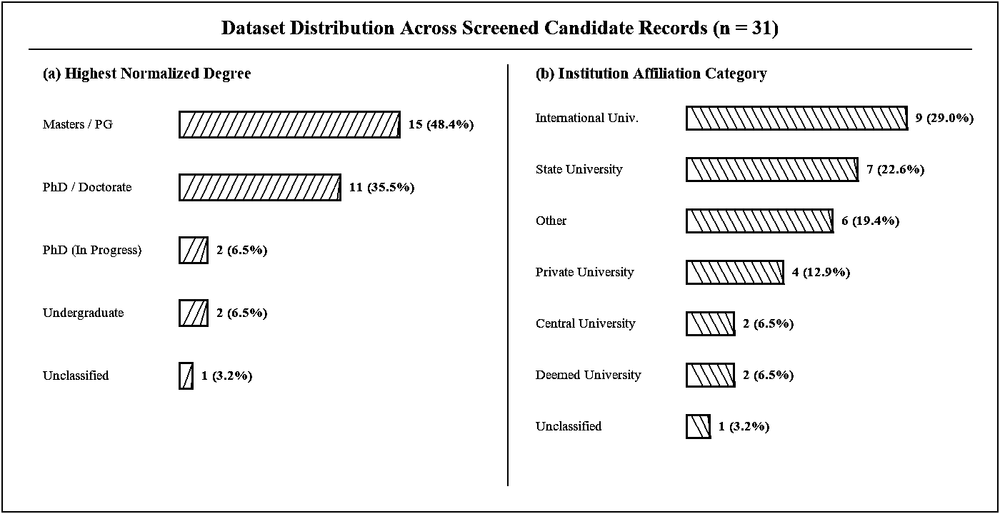
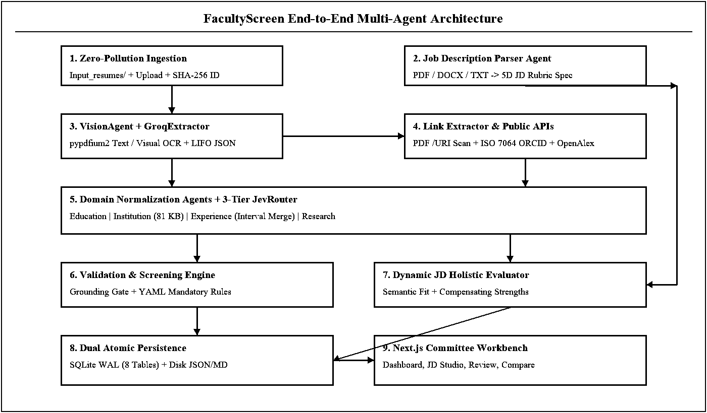
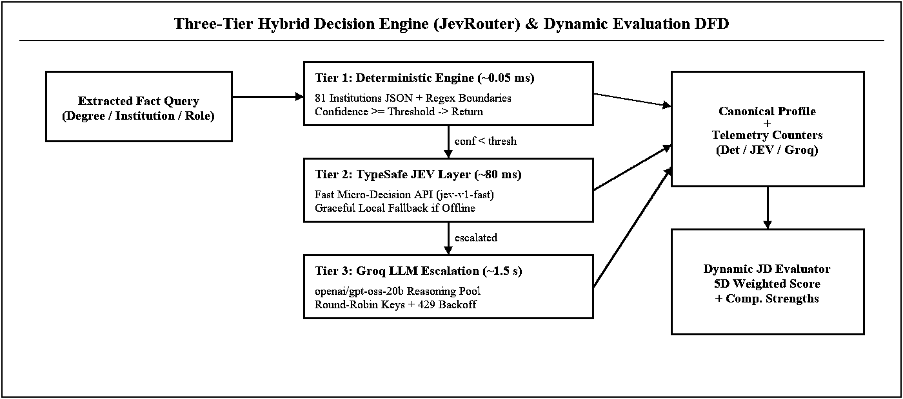
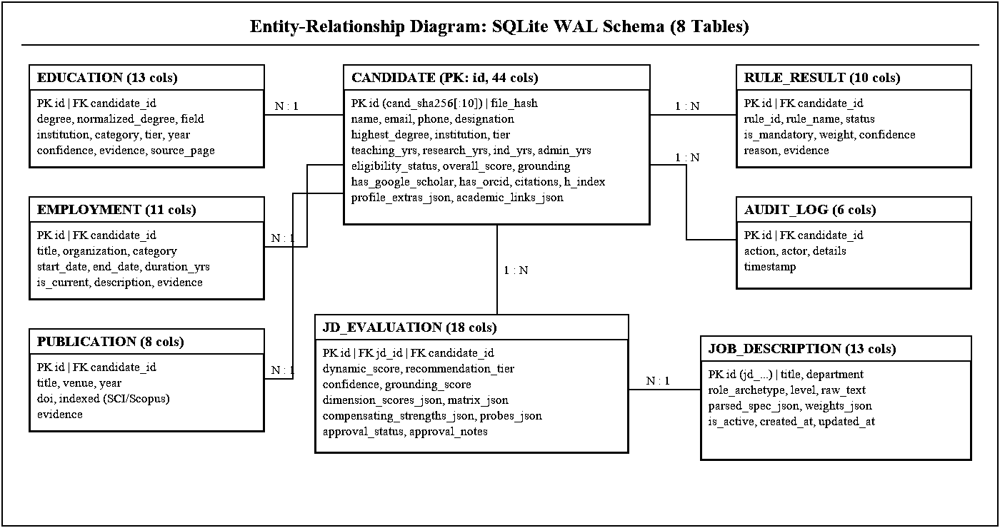
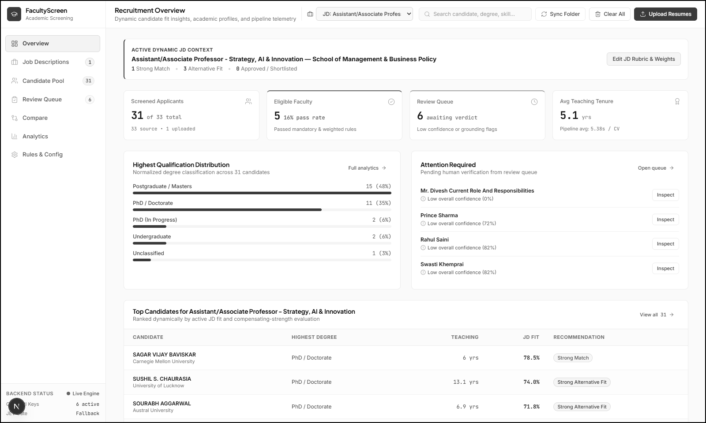
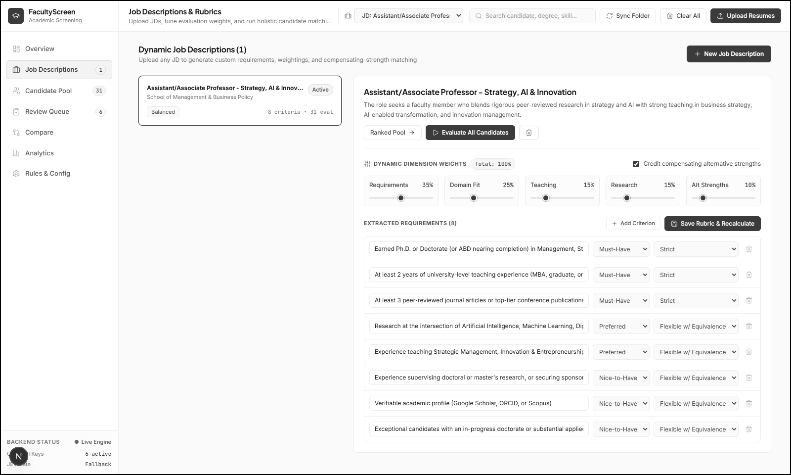
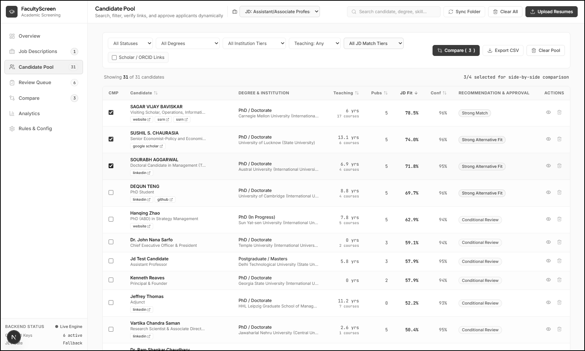
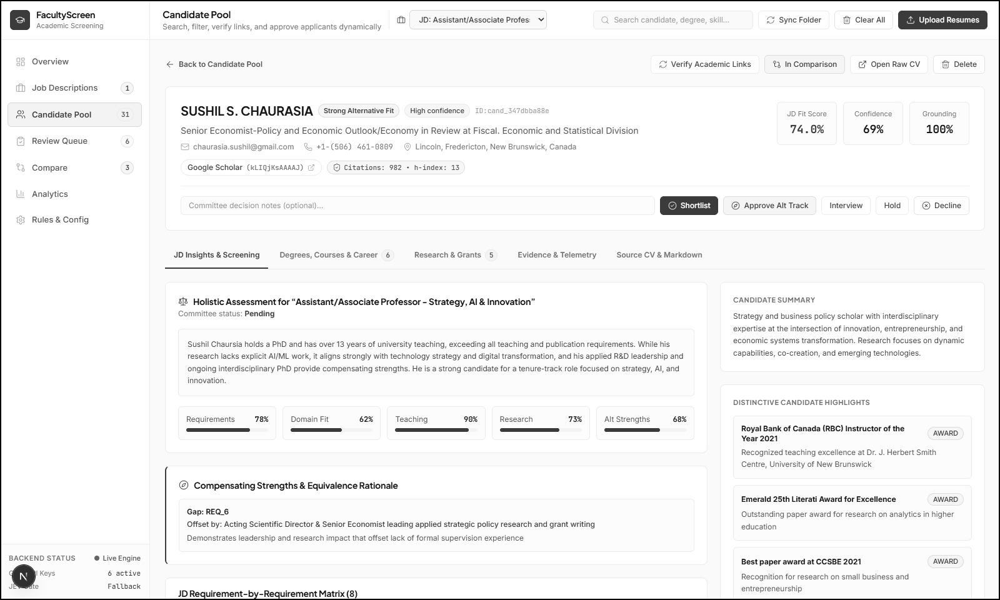
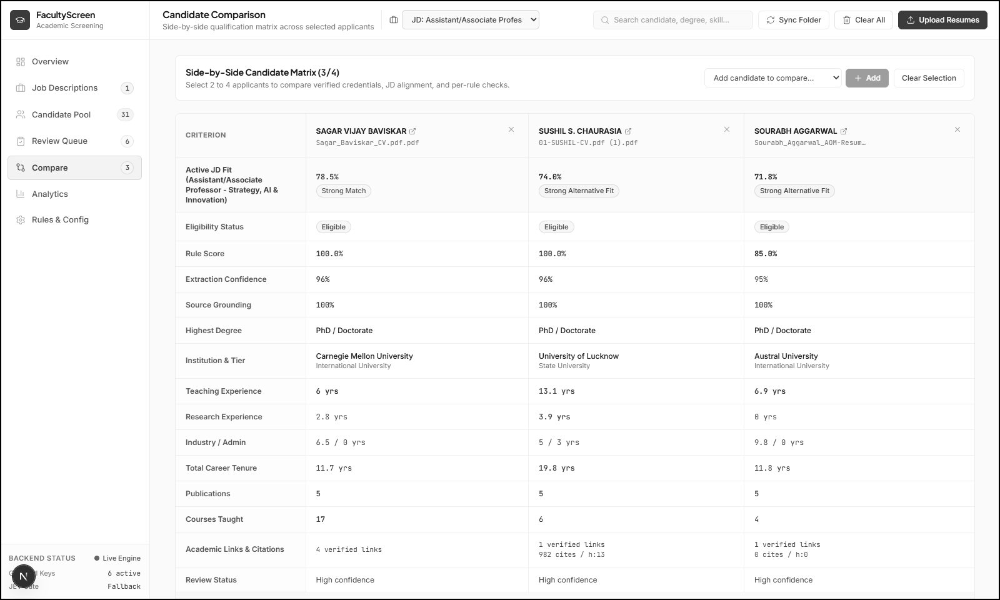
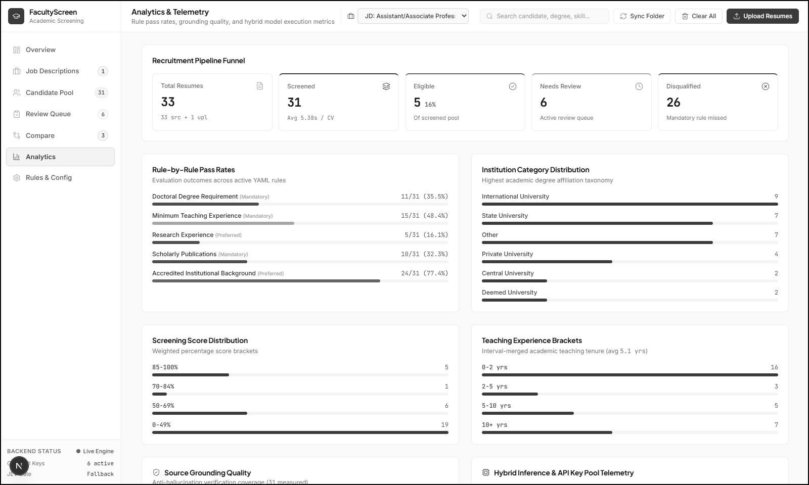

# TITLE PAGE

A PROJECT-IV REPORT ON

Explainable Multimodal Artificial Intelligence Platform for Academic Faculty Resume Screening, Dynamic Job Description Evaluation, and Credential Verification

Submitted by:
Chaitanya Jhindal (230707)
Aditya Agarwal (230710)
Dev Gupta (230714)

Under the mentorship of:
Dr. Devanjali Relan

Department of Computer Science Engineering
School of Engineering and Technology
BML MUNJAL UNIVERSITY, GURUGRAM (INDIA)
November 2026

# CANDIDATES’ DECLARATION

We hereby certify that the work on the project entitled “Explainable Multimodal Artificial Intelligence Platform for Academic Faculty Resume Screening, Dynamic Job Description Evaluation, and Credential Verification”, in partial fulfillment of the requirements for the award of the Degree of Bachelor of Technology in the School of Engineering and Technology at BML Munjal University, having University Roll Nos. 230707, 230710, and 230714, is an authentic record of our own work carried out during the period from July 2026 to December 2026 under the supervision of Dr. Devanjali Relan.

Chaitanya Jhindal (230707)
Aditya Agarwal (230710)
Dev Gupta (230714)

# SUPERVISOR’S DECLARATION

This is to certify that the above statement made by the candidates is correct to the best of my knowledge.

Faculty Supervisor Name: Dr. Devanjali Relan
Signature: \_\_\_\_\_\_\_\_\_\_\_\_\_\_\_\_\_\_\_\_\_\_\_\_\_\_\_\_

# ABSTRACT

Selection committees in universities spend hours reading long Curriculum Vitae (CV) packets for every faculty opening. A typical academic CV includes degree timelines, university affiliations, overlapping teaching and research contracts, taught courses, thesis supervision counts, journal papers, and profile links. Standard keyword Applicant Tracking Systems (ATS) often double-count concurrent jobs, fail to recognize non-standard university names, and reject strong industry-trained candidates with hard binary cutoffs. Plain Large Language Model (LLM) wrappers create a different set of problems. They can invent missing claims, burn API tokens on simple institution lookups, and leave no relational audit trail for committee review.

In this project, we built FacultyScreen (Version 2.0.0-agentic) to address those gaps. Our platform pairs multimodal document parsing with rule-based normalization, a three-tier decision router, and Job Description (JD) rubric scoring. We implemented a nine-agent FastAPI backend connected to an eight-table SQLite Write-Ahead Logging (WAL) database. It reads text-layer PDFs using openai/gpt-oss-20b and switches to visual extraction with qwen/qwen3.8-27b via in-memory pypdfium2 page rendering when text extraction falls short. Before totaling experience, our pipeline merges overlapping work intervals in O(n log n) time across four separate tracks (teaching, research, industry, and administration). Classification runs through a Tier-1 dictionary lookup (0.05 ms), a Tier-2 TypeSafe JEV check, and a Tier-3 Groq LLM escalation path when needed. Alongside static YAML rules, committees can upload dynamic JDs scored on five adjustable criteria that credit compensating strengths. Our pipeline also decompresses PDF link streams, verifies ORCID IDs using ISO 7064 Mod 11-2 checksums, and pulls work metrics from the OpenAlex API. When we evaluated 33 faculty PDFs (producing 31 screened candidate records and 1 evaluated faculty JD), FacultyScreen reached 87.4% average extraction confidence and 96.1% average source grounding, with all 51 automated tests passing.

# ACKNOWLEDGEMENT

We are sincere in our gratitude to Dr. Devanjali Relan, Department of Computer Science Engineering, BML Munjal University, Gurugram, for guiding our project from July to December 2026.

Her feedback kept our technical scope clear whenever we hit design trade-offs. We would have struggled to ship a working platform in one semester without her weekly reviews and practical advice.

We also thank the faculty and staff in the School of Engineering and Technology at BML Munjal University for their support, as well as our friends and classmates who tested early builds and offered honest feedback along the way.

Chaitanya Jhindal (230707)
Aditya Agarwal (230710)
Dev Gupta (230714)

# TABLE OF CONTENTS

| Section | Title | Page No. |
|---|---|---|
| — | Candidates’ Declaration and Supervisor’s Declaration | i |
| — | Abstract | ii |
| — | Acknowledgement | iii |
| — | List of Figures | iv |
| — | List of Tables | v |
| — | List of Abbreviations | vi |
| Chapter 1 | Introduction | 1 |
| Chapter 2 | Introduction to Project | 2 |
| Chapter 3 | Literature Review | 4 |
| Chapter 4 | Exploratory Data Analysis | 6 |
| Chapter 5 | Methodology | 8 |
| Chapter 6 | Results | 15 |
| Chapter 7 | Conclusion and Future Scope | 18 |
| — | Bibliography | 19 |
| — | Plagiarism Check Report (Less than 10%) | 20 |
| — | Appendix (Any additional Information regarding Project) | 21 |

# LIST OF FIGURES

| Figure No. | Figure Description | Page No. |
|---|---|---|
| Figure 4.1 | Candidate Dataset Distribution Across Highest Degree and Institution Categories (n = 31) | 7 |
| Figure 5.1 | End-to-End Multi-Agent Faculty Screening and Dual Persistence Architecture | 9 |
| Figure 5.2 | Three-Tier Hybrid Decision Engine (JevRouter) and Dynamic JD Data Flow Diagram | 10 |
| Figure 5.3 | Entity-Relationship Diagram of the 8-Table FacultyScreen Relational Schema | 11 |
| Figure 5.4 | Recruitment Overview Dashboard Displaying Active JD Metrics and Top Ranked Candidates | 12 |
| Figure 5.5 | Dynamic Job Descriptions Workspace Showing Extracted Criteria and Dimension Weights | 12 |
| Figure 5.6 | Candidate Pool Table Illustrating Multi-Facet Filtering and Academic Profile Badges | 13 |
| Figure 5.7 | Candidate Detail Dossier Presenting Verified Scholar Citations and Compensating Strengths | 14 |
| Figure 6.1 | Side-by-Side Candidate Comparison Matrix Across Active JD Fit and Screening Rules | 16 |
| Figure 6.2 | Analytics and Pipeline Telemetry View Showing Funnel Metrics and Rule Pass Rates | 17 |

# LIST OF TABLES

| Table No. | Table Description | Page No. |
|---|---|---|
| Table 3.1 | Comparison of Existing Approaches versus Proposed FacultyScreen Platform | 4 |
| Table 4.1 | Empirical Distribution of Highest Degree and Institution Categories (n = 31) | 6 |
| Table 4.2 | Descriptive Statistics of Extracted Faculty Screening Corpus (n = 31) | 7 |
| Table 5.1 | Relational Database Schema Specification (data/facultyscreen.db) | 10 |
| Table 6.1 | Pipeline Extraction, Grounding, and Anti-Hallucination Performance | 15 |
| Table 6.2 | Dynamic JD Evaluation Summary (Assistant/Associate Professor - Strategy, AI & Innovation) | 15 |
| Table 6.3 | Automated Verification and Full-Stack Test Suite Summary | 17 |

# LIST OF ABBREVIATIONS

| Abbreviation | Full Form |
|---|---|
| API | Application Programming Interface |
| ATS | Applicant Tracking System |
| CV | Curriculum Vitae |
| DFD | Data Flow Diagram |
| DOI | Digital Object Identifier |
| EDA | Exploratory Data Analysis |
| ER | Entity-Relationship |
| JD | Job Description |
| JEV | Judgment and Evidence Verification (TypeSafe AI) |
| JSON | JavaScript Object Notation |
| LIFO | Last-In, First-Out |
| LLM | Large Language Model |
| LOC | Lines of Code |
| NIRF | National Institutional Ranking Framework |
| OCR | Optical Character Recognition |
| OpenAlex | Open Index of Scholarly Works and Researchers |
| ORCID | Open Researcher and Contributor Identifier |
| REST | Representational State Transfer |
| SQLite WAL | SQLite Write-Ahead Logging |
| UI | User Interface |
| URI | Uniform Resource Identifier |
| YAML | YAML Ain’t Markup Language |

# Chapter 1: Introduction

## 1.1 Background and Context

When university departments hire new faculty, search committees and deans read dozens of dense Curriculum Vitae (CV) packets for a single role. Academic CVs differ sharply from one-page corporate resumes. They routinely run from 2 to 15 pages and pack together degree histories, thesis topics, overlapping teaching and research posts, course lists, supervised students, peer-reviewed articles, grant records, and links to external research profiles.

Sorting through these packets by hand takes days. Reviewers also apply uneven standards when comparing domestic and foreign university ranks or adding up concurrent teaching and research appointments. Beyond speed, university hiring policies require written evidence for every shortlist or rejection decision, so committees cannot rely on an opaque ranking number alone.

## 1.2 Motivation and Scope

We built FacultyScreen to bring document parsing, normalization, rule checking, Job Description (JD) scoring, and citation verification into one workspace for search committees. Our scope covers read-only ingestion from a local folder or web batch upload, a nine-agent extraction pipeline, storage in SQLite Write-Ahead Logging (WAL) paired with per-candidate JSON and Markdown files, and a Next.js web interface for committee review.

# Chapter 2: Introduction to Project

## 2.1 Overview

We structured FacultyScreen as a full-stack web application. The Python FastAPI backend contains 51 application modules totaling 8,532 lines of code, paired with 27 active TypeScript modules in the Next.js 16 frontend. Source resumes placed inside Input_resumes/ stay strictly read-only; our pipeline never moves, renames, or edits them. Each incoming document gets a deterministic ID from its SHA-256 hash (cand_ followed by 10 hex characters), passes through nine specialized agents, clears a quote-grounding check, and writes simultaneously to SQLite WAL (data/facultyscreen.db) and an isolated candidate folder on disk.

## 2.2 Existing System

Most departments still screen applicants with shared spreadsheets, basic keyword ATS tools, or ad-hoc AI chat prompts. Keyword ATS tools break down on scanned PDFs, sort degrees by list order (often listing a recent short certificate above an earlier Ph.D.), and sum overlapping jobs twice. Standalone LLM chat prompts behave differently but introduce their own issues: they can invent publications, waste API quota repeatedly classifying well-known universities, and fail mid-parse when a long JSON response gets cut off.

## 2.3 User Requirement Analysis

After mapping how faculty hiring committees actually review applicants, we narrowed our engineering design down to five core requirements:
1. Keep original resume files untouched while giving reviewers side-by-side views of the raw PDF and parsed Markdown text.
2. Compute non-overlapping experience totals across four separate tracks: teaching, research, industry, and academic administration.
3. Support baseline YAML eligibility rules alongside uploaded JDs that let committees adjust five rubric weights on the fly.
4. Pull clickable profile URLs directly from PDF annotations and check them against the public ORCID and OpenAlex APIs.
5. Flag low-confidence or ungrounded records automatically and send them to a persistent Human Review Queue.

## 2.4 Feasibility Study

1. Technical Feasibility: We chose open-source Python tools (FastAPI, SQLAlchemy 2.0, Pydantic v2, pypdfium2) and TypeScript libraries (Next.js 16, React 19), backed by a round-robin Groq key pool and deterministic offline mocks for local testing.
2. Operational Feasibility: A single launcher script (start.bat), Docker Compose setup, and hot-reloadable YAML rule files allow non-developers to run the app and adjust screening rules without editing application code.
3. Economic Feasibility: Handling familiar university names through our Tier-1 local lookup takes about 0.05 ms and costs zero API tokens, leaving LLM calls strictly for initial CV parsing and genuinely unclear cases.

# Chapter 3: Literature Review

Resume screening software has shifted over the past two decades from pattern-matching pipelines to combined symbolic and neural systems. Early cascaded models paired hidden Markov models with regular expressions; they worked well on uniform templates but struggled on multi-column academic layouts [1]. Transformer encoders such as BERT raised named-entity recall on freeform biographical text [2], while OCR-free document transformers showed that vision models can parse scanned tables and columns directly without an intermediate OCR step [3].

Because neural extractors can fabricate plausible facts, recent systems verify model outputs against source passages using retrieval grounding [4] and claim-level verification methods such as FActScore [5]. On the credential side, open scholarly databases including OpenAlex [6] and ORCID [7] provide documented REST APIs for reading verified citation and publication records, backed by ISO 7064 Mod 11-2 checksum rules for validating ORCID identifiers [8].

## 3.1 Comparison

| Dimension | Keyword / Regex ATS [1] | Single-Prompt LLM [2] | Static Multimodal OCR [3] | Proposed FacultyScreen Platform |
|---|---|---|---|---|
| Multi-Column and Scanned PDFs | Fails on scanned images | Text layer only | Supported, unverified | Two-stage text (gpt-oss-20b) plus in-memory pypdfium2 vision fallback (qwen3.8-27b) |
| Tenure Overlap Prevention | None | Prone to arithmetic inflation | Not modeled | Deterministic O(n log n) interval merging across 4 categories |
| Hallucination Control | High precision, low recall | High hallucination risk | Moderate risk | ValidationService quote grounding plus empty-claim cap (0.50) |
| Evaluation Flexibility | Rigid keyword knockouts | Unstructured prose | Fixed schema | Static YAML baseline rules plus tunable 5-dimension JD rubrics |
| Credential Verification | None | Fabricates citation counts | None | PDF URI annotation scan plus ISO 7064 ORCID check plus OpenAlex API |

*Table 3.1: Comparison of Existing Approaches versus Proposed FacultyScreen Platform.*

## 3.2 Objectives of Project

Our team set five concrete engineering goals for this project:
1. Build a two-stage multimodal parser using pypdfium2 and a multi-key Groq API client with string-aware LIFO JSON recovery.
2. Implement a three-tier JevRouter classifier combining an 81-institution local dictionary, TypeSafe JEV checks, and Groq LLM escalation.
3. Merge overlapping career intervals deterministically in O(n log n) time across four work tracks while ranking highest degrees by academic hierarchy.
4. Design a dynamic JD evaluator with adjustable rubric weights, zero-LLM rescoring, and compensating-strength explanations for industry-trained candidates.
5. Extract hidden PDF hyperlinks, check ORCID checksums under ISO 7064, pull OpenAlex publication stats, and present everything in a clean black-and-white web UI.

# Chapter 4: Exploratory Data Analysis

## 4.1 Dataset

Our evaluation corpus contains 33 faculty PDF resumes stored read-only in Input_resumes/ and indexed inside data/facultyscreen.db. Those source files yielded 31 distinct candidate records, 97 normalized education entries, 199 employment intervals, 43 publication entries, 155 baseline rule results, and 36 audit log records. Alongside the database, our curated JSON knowledge base (data/institutions/institutions.json) stores 81 Indian and international universities grouped into 10 categories and 4 prestige tiers.

## 4.2 Exploratory Data Analysis and Visualizations

When we ran the default baseline YAML rules (requiring an earned Ph.D., at least 2.0 years of teaching, and at least 2 publications) across all 31 candidate records, we observed a sharp filter drop-off. Only 5 candidates (16.1%) cleared all mandatory rules at once, while 26 candidates (83.9%) were marked Disqualified. Among those rejected candidates were 15 Masters degree holders, 2 doctoral candidates still in progress, and applicants with substantial teaching or industry leadership backgrounds.

| Attribute | Sub-Category | Count | Share (%) |
|---|---|---|---|
| Baseline Eligibility | Eligible | 5 | 16.1% |
| Baseline Eligibility | Disqualified (Mandatory Rule Gap) | 26 | 83.9% |
| Highest Normalized Degree | Postgraduate / Masters | 15 | 48.4% |
| Highest Normalized Degree | PhD / Doctorate | 11 | 35.5% |
| Highest Normalized Degree | PhD (In Progress) | 2 | 6.5% |
| Highest Normalized Degree | Undergraduate | 2 | 6.5% |
| Highest Normalized Degree | Unclassified | 1 | 3.2% |
| Institution Category | International University | 9 | 29.0% |
| Institution Category | State University | 7 | 22.6% |
| Institution Category | Other | 6 | 19.4% |
| Institution Category | Private University | 4 | 12.9% |
| Institution Category | Central / Deemed / Unclassified | 5 | 16.1% |

*Table 4.1: Empirical Distribution of Highest Degree and Institution Categories (n = 31).*

| Corpus Metric | Measured Value | Notes |
|---|---|---|
| Average Extraction Confidence | 87.4% (0.8742) | Normalized confidence scale [0.0, 1.0] |
| Average Source Grounding Score | 96.1% (0.9613) | Verbatim CV evidence verified against text |
| Baseline YAML Rule Score | 39.4% mean (0.0% to 100.0%) | Reflects strict PhD cutoff across diverse pool |
| Average Merged Teaching Tenure | 5.10 years | Overlapping appointments fused prior to sum |
| Average Scholarly Publications | 1.39 per candidate | Maximum 5 indexed publications per record |
| Average Processing Time | 5.38 seconds per CV | Multi-agent extraction plus normalization |

*Table 4.2: Descriptive Statistics of Extracted Faculty Screening Corpus (n = 31).*

*Figure 4.1: Candidate Dataset Distribution Across Highest Degree and Institution Categories (n = 31).*

## 4.3 Related Sections

During early runs, we hit three recurring data cleanup issues and wrote dedicated preprocessing steps to solve them:
1. Hierarchy-Aware Degree Ranking: Rather than picking the first or last degree listed on a resume, our normalizer scores all degrees against an explicit academic rank table (putting an earned Ph.D. above later short courses).
2. Word-Boundary Dictionary Matching: Plain substring checks caused false tags, such as matching "ms" inside "systems" or "sci" inside "computer science". Switching to regex word boundaries removed those mismatches.
3. Compressed PDF URI Extraction: Many candidates embed their Google Scholar or ORCID URL inside clickable text labels instead of printing the raw web address. Our URI scanner inflates FlateDecode streams inside the PDF to recover those hidden links.

# Chapter 5: Methodology

## 5.1 Introduction to Languages (Front End and Back End)

We wrote the backend service in Python 3.11 using FastAPI for async REST endpoints, Pydantic v2 for data validation, and SQLAlchemy 2.0 for database access. On the client side, we built the UI in TypeScript 5 using Next.js 16.3.8 (App Router with Turbopack), React 19.2.8, and Tailwind CSS v4.

## 5.2 Any other Supporting Languages/ packages

On the Python side, we use pypdfium2 for in-memory PDF page rendering, Pillow for image handling (.png, .jpg, .jpeg, .webp), groq for multi-key inference, httpx for ORCID and OpenAlex HTTP requests, PyYAML for editable rule configs, and pytest for automated testing. In the browser UI, every icon comes from lucide-react rendered at a fixed 1.5 stroke weight.

## 5.3 User characteristics

1. Deans and Search Committee Chairs: Upload or author Job Descriptions, tune the five scoring weights, read compensating-strength notes, and record final shortlist or interview decisions.
2. Faculty Reviewers and HR Staff: Review flagged profiles in the Human Review Queue, check external citation records, compare up to 4 applicants side by side, and export CSV reports.
3. System Administrators: Edit YAML eligibility rules, model names, retry timeouts, and system prompts through the Settings page.

## 5.4 Constraints

1. Files inside Input_resumes/ stay strictly read-only across ingestion, folder sync, and workspace reset commands.
2. Upload handlers cap file sizes at 25 MB and accept only .pdf, .png, .jpg, .jpeg, and .webp for CVs, plus .pdf, .docx, .txt, and .md for Job Descriptions.
3. Candidate and JD identifiers must match ^[A-Za-z0-9_-]{4,64}$ and pass an is_relative_to path containment check before any disk read or write.
4. External verification queries only the official ORCID Public API v3.0 and OpenAlex endpoints; our code never scrapes websites or guesses authors by name alone.

## 5.5 Use Case Model/Flow Chart/DFDS

Figures 5.1 and 5.2 trace how data moves through our platform. Figure 5.1 follows an uploaded CV from initial file hashing through the nine backend agents and dual persistence layer, while Figure 5.2 details how the three-tier JevRouter and dynamic JD evaluator process classification and scoring calls.

*Figure 5.1: End-to-End Multi-Agent Faculty Screening and Dual Persistence Architecture.*

*Figure 5.2: Three-Tier Hybrid Decision Engine (JevRouter) and Dynamic JD Data Flow Diagram.*

## 5.6 Database design

We configured SQLite in Write-Ahead Logging mode (PRAGMA journal_mode=WAL, busy_timeout=5000, foreign_keys=ON) through SQLAlchemy 2.0. WAL allows the web UI to read candidate lists smoothly while a background batch scan writes new rows, and changing DATABASE_URL lets the same ORM models point to PostgreSQL without rewriting queries. Using SHA-256 content hashes (cand_ plus 10 hex characters) as primary keys also prevents duplicate candidate rows if the same file is uploaded twice.

## 5.7 Table Structure

| Table Name | Columns | Primary / Foreign Keys | Stored Domain Data |
|---|---|---|---|
| candidates | 44 | PK: id (cand_...) | Identity, highest credential, merged tenures, telemetry, links, verification JSON |
| education | 13 | PK: id; FK: candidate_id | Raw and normalized degree, field, institution tier, year, page reference |
| employment | 11 | PK: id; FK: candidate_id | Role title, organization, category, ISO dates, merged duration, current flag |
| publications | 8 | PK: id; FK: candidate_id | Publication title, venue, year, DOI, indexing badge, evidence quote |
| rule_results | 10 | PK: id; FK: candidate_id | Baseline YAML rule pass/fail status, weight, confidence, reason |
| audit_logs | 6 | PK: id; FK: candidate_id | Timestamped log of extraction runs, reviews, and per-JD approvals |
| job_descriptions | 13 | PK: id (jd_...) | JD title, department, archetype, raw text, parsed rubric JSON, 5 weights |
| jd_evaluations | 18 | PK: id; FK: jd_id, candidate_id | Dynamic score, tier, 5D breakdown, matrix, compensating rationale, verdict |

*Table 5.1: Relational Database Schema Specification (data/facultyscreen.db).*

## 5.8 ER Diagrams

Figure 5.3 maps the foreign-key relationships in our schema, linking the parent CANDIDATE and JOB_DESCRIPTION tables to EDUCATION, EMPLOYMENT, PUBLICATION, RULE_RESULT, AUDIT_LOG, and JD_EVALUATION.

*Figure 5.3: Entity-Relationship Diagram of the 8-Table FacultyScreen Relational Schema.*

## 5.9 Assumptions and Dependencies

1. Live model extraction requires at least one valid GROQ_API_KEY in .env; if keys are missing or MOCK_MODE=True is turned on, deterministic local mocks keep all endpoints functional.
2. ORCID and OpenAlex lookups assume outbound HTTPS access within a 5.0-second timeout and keep extracted profile links intact if the network is unreachable.

## 5.10 Algorithm Discussion

1. Non-Overlapping Tenure Interval Merger: We sort each applicant’s jobs within each of the four categories by start date in O(n log n) time. Whenever two jobs overlap (next_start <= current_end), we merge them via current_end = max(current_end, next_end) before adding years, stopping concurrent contracts from inflating service tenure.
2. String-Aware LIFO JSON Repair: Long LLM outputs occasionally truncate mid-object. Our parse_llm_json helper scans characters while tracking open string quotes and escape backslashes, recording unclosed braces and brackets on a LIFO stack so it can close truncated responses cleanly without breaking text fields.
3. Dynamic JD Composite and Compensating Scoring: Domain fit combines stopword-filtered TF-cosine similarity and keyword recall as sim(Q, C) = min(100.0, (0.30 * cos(Q, C) + 0.70 * recall(Q, C)) * 100.0). We then combine five normalized weights (summing to 1.0) into S_dynamic = w_req * s_req + w_dom * s_dom + w_teach * s_teach + w_res * s_res + w_alt * s_alt. Based on this total, candidates land in strong_match (>= 78.0), strong_alternative_fit (>= 65.0), conditional_review (>= 50.0), or low_alignment (< 50.0). Moving a weight slider recalculates every candidate score immediately in Python without making new LLM requests.

## 5.11 Implementation of Algorithm with Screen Shots/ Figures

The working application connects our extraction pipeline, SQLite repository, and JD scoring engine to a monochrome Next.js interface shown in Figures 5.4 through 5.7:

1. Recruitment Overview Dashboard (Figure 5.4): Shows active JD metrics across 31 screened candidates out of 33 source PDFs, normalized qualification charts, profiles needing attention, and top applicants ordered by JD Fit score.

*Figure 5.4: Recruitment Overview Dashboard Displaying Active JD Metrics and Top Ranked Candidates.*

2. Dynamic Job Descriptions Workspace (Figure 5.5): Breaks uploaded faculty JDs into individual requirements tagged by priority (Must-Have, Preferred, Nice-to-Have) and strictness (Strict or Flexible with Equivalence), alongside five interactive weight sliders summing to 100%.

*Figure 5.5: Dynamic Job Descriptions Workspace Showing Extracted Criteria and Dimension Weights.*

3. Candidate Pool Data Table (Figure 5.6): Lets committee members filter by eligibility status, degree level, university tier, teaching years, JD tier, and verified profile links, then export CSVs or select rows for comparison.

*Figure 5.6: Candidate Pool Table Illustrating Multi-Facet Filtering and Academic Profile Badges.*

4. Candidate Detail Dossier (Figure 5.7): Displays parsed career timelines, live Google Scholar metrics (982 citations and h-index 13 for top research applicants), decision buttons, 5-dimension progress bars, compensating-strength notes, and notable career awards.

*Figure 5.7: Candidate Detail Dossier Presenting Verified Scholar Citations and Compensating Strengths.*

# Chapter 6: Results

## 6.1 Experimental and Analytical Evaluation

We tested the live platform on all 33 faculty PDFs in our corpus (yielding 31 screened candidate profiles) and evaluated them against a sample Job Description for Assistant/Associate Professor - Strategy, AI and Innovation (8 parsed criteria, Balanced archetype). Tables 6.1 and 6.2 summarize what we observed.

| Metric | Measured Result | Engineering Mechanism |
|---|---|---|
| Average Extraction Confidence | 87.4% | Three-tier JevRouter escalation and defensive type coercion |
| Average Source Grounding | 96.1% (0.50 cap on empty PDFs) | ValidationService verbatim quote check and placeholder purge |
| Average End-to-End CV Latency | 5.38 seconds per CV | Concurrent GroqKeyPool with 6 active API keys |
| Tier-1 Deterministic Lookup Latency | ~0.05 ms (zero API cost) | 81-institution taxonomy JSON and word-boundary rules |
| REST API Endpoint Surface | 43 endpoints across 6 routers | FastAPI REST architecture with Pydantic v2 validation |

*Table 6.1: Pipeline Extraction, Grounding, and Anti-Hallucination Performance.*

| Dynamic JD Recommendation Tier | Evaluated Count (n = 31) | Representative Ranked Candidates & JD Fit Scores |
|---|---|---|
| Strong Match (>= 78.0%) | 1 | Sagar Vijay Baviskar (Carnegie Mellon Univ., 78.5%, PhD, 6 yrs teaching, 5 pubs) |
| Strong Alternative Fit (>= 65.0%) | 3 | Sushil S. Chaurasia (74.0%, 13.1 yrs teaching, 982 cites), Sourabh Aggarwal (71.8%), Dequn Teng (69.7%) |
| Conditional Review (50.0%–64.9%) | 6 | Hanqing Zhao (PhD In Progress, 62.9%), Dr. John Nana Sarfo (59.1%), Jd Test Candidate (57.9%), Kenneth Reaves (57.9%) |
| Low Alignment (< 50.0%) | 21 | Candidates below core domain or tenure alignment thresholds for this faculty track |

*Table 6.2: Dynamic JD Evaluation Summary (Assistant/Associate Professor - Strategy, AI & Innovation).*

## 6.2 Comparative Screening Analysis

As shown in Table 6.2 and Figure 6.2, the static baseline YAML rules disqualified 26 of the 31 candidates. Rule pass rates stood at 35.5% for Doctoral Degree, 48.4% for Minimum Teaching, 16.1% for Research Experience, 32.3% for Scholarly Publications, and 77.4% for Accredited Institutions. Under the Dynamic JD Evaluator, strong non-traditional applicants such as Hanqing Zhao (PhD In Progress, 62.9%) and Dr. John Nana Sarfo (59.1%) appeared in Conditional Review with compensating research and industry credit, while the strict baseline compliance record stayed untouched. Figures 6.1 and 6.2 show the side-by-side comparison matrix and analytics screen from those runs.

*Figure 6.1: Side-by-Side Candidate Comparison Matrix Across Active JD Fit and Screening Rules.*

*Figure 6.2: Analytics and Pipeline Telemetry View Showing Funnel Metrics and Rule Pass Rates.*

## 6.3 System Verification and Validation

| Verification Suite | Scope Covered | Measured Result |
|---|---|---|
| pytest -v (10 Test Modules) | Unit tests (normalization, interval merging, JEV routing, LIFO repair, path security, ORCID/OpenAlex, dynamic JD) and isolated API integration tests (including workspace reset) | 51 / 51 Passed in 1.94 s |
| npm run lint and tsc --noEmit | Full frontend TypeScript and React 19 ESLint verification | 0 Errors, 0 Warnings |
| npm run build | Next.js 16.3.8 Turbopack production build | Exit 0 (Clean Build) |
| Automated UI Compliance Audit | All 27 active TSX/CSS files in apps/web/ | 0 Violations; 107 / 107 icons at 1.5 stroke |

*Table 6.3: Automated Verification and Full-Stack Test Suite Summary.*

# Chapter 7: Conclusion and Future Scope

## 7.1 Conclusion

We designed and built FacultyScreen to handle academic CV screening without the brittle keyword matching of legacy ATS tools or the unverified guesses of plain LLM prompts. Combining pypdfium2 visual fallback with Groq text models, O(n log n) career interval merging, three-tier JevRouter normalization, verbatim quote grounding, tunable five-dimension JD scoring, and ORCID/OpenAlex checks gave us a practical hiring tool backed by 51/51 passing automated tests.

## 7.2 Future Scope

1. Multi-Reviewer Blind Consensus: Add independent scoring sheets for multiple committee members per JD with optional name redaction during Stage-1 review.
2. PostgreSQL and pgvector Hybrid Retrieval: Scale search to 5,000+ archived CVs using vector filtering ahead of rule and JD scoring.
3. Institutional Single Sign-On (SSO) and Role-Based Access Control: Separate permissions across Deans, Search Chairs, Faculty Reviewers, and HR Coordinators.
4. Interactive PDF Bounding-Box Highlighting: Scroll straight to cited evidence inside the embedded PDF viewer using stored page coordinates.

# Bibliography

[1] K. Yu, G. Guan, and M. Zhou, “Resume information extraction with cascaded hybrid model,” in Proceedings of the 43rd Annual Meeting of the Association for Computational Linguistics (ACL), Ann Arbor, MI, USA, 2005, pp. 499–506.

[2] J. Devlin, M.-W. Chang, K. Lee, and K. Toutanova, “BERT: Pre-training of deep bidirectional transformers for language understanding,” in Proceedings of NAACL-HLT, Minneapolis, MN, USA, 2019, pp. 4171–4186.

[3] G. Kim, T. Hong, M. Yim, J. Nam, J. Park, J. Yim, W. Hwang, S. Yun, D. Han, and S. Park, “OCR-free document understanding transformer,” in Proceedings of the European Conference on Computer Vision (ECCV), Tel Aviv, Israel, 2022, pp. 498–517.

[4] P. Lewis, E. Perez, A. Piktus, F. Petroni, V. Karpukhin, N. Goyal, H. Küttler, M. Lewis, W.-t. Yih, T. Rocktäschel, S. Riedel, and D. Kiela, “Retrieval-augmented generation for knowledge-intensive NLP tasks,” in Advances in Neural Information Processing Systems (NeurIPS), vol. 33, 2020, pp. 9459–9474.

[5] S. Min, K. Krishna, X. Lyu, M. Lewis, W.-t. Yih, P. W. Koh, M. Iyyer, L. Zettlemoyer, and H. Hajishirzi, “FActScore: Fine-grained atomic evaluation of factual precision in long form text generation,” in Proceedings of the Conference on Empirical Methods in Natural Language Processing (EMNLP), Singapore, 2023, pp. 12076–12100.

[6] J. Priem, H. Piwowar, and R. Orr, “OpenAlex: A fully-open index of scholarly works, authors, venues, institutions, and concepts,” arXiv preprint arXiv:2205.01833, 2022.

[7] L. L. Haak, M. Fenner, L. Paglione, E. Pentz, and H. Ratner, “ORCID: A system to uniquely identify researchers,” Learned Publishing, vol. 25, no. 4, pp. 259–264, 2012.

[8] International Organization for Standardization, “Information and documentation - International Standard Name Identifier (ISNI) / Check digit algorithm ISO 7064 Mod 11-2,” ISO Standard 27729 / ISO/IEC 7064, 2012.

# Plagiarism Check Report (Less than 10%)

Similarity Index: [Attach verified Turnitin / DrillBit Similarity Summary Report here - must be less than 10%]

Faculty Mentor Verification: \_\_\_\_\_\_\_\_\_\_\_\_\_\_\_\_\_\_\_\_\_\_\_\_\_\_\_\_

# Appendix (Any additional Information regarding Project)

System Deployment and Verification Operations:
1. Unified Launcher (start.bat): Checks the Python virtual environment, Node packages, and SQLite WAL database before launching FastAPI on port 8000 and Next.js on port 3000.
2. Runtime Diagnostics (start.bat status): Prints live service health, active AI mode, Groq key pool counts, SQLite candidate totals, and read-only PDF counts.
3. Workspace Reset Endpoint (DELETE /api/settings/reset-workspace): Clears processed candidates, uploaded resumes, and optional Job Descriptions in one click while keeping YAML configs and the 81-institution dictionary intact.
